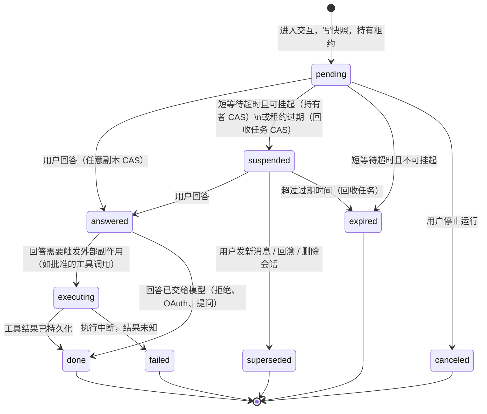

# Agent 人工交互（HITL）：两段式挂起与恢复

状态：草案（P1 已实现）　关联：issue #1173（MCP 工具人工审批）

## 0. 范围：通用人工交互，而不只是工具审批

“Agent 停下来等人”有多种形态，本设计把它们统一成一个模型：**交互请求（prompt）**。一条交互请求有类型（`kind`）、请求载荷（`request`）和用户回答（`response`），由通用核心 `internal/agent/hitl.Broker` 负责持久化、等待、跨副本投递和挂起恢复；各类型只提供载荷结构、回答校验和前端卡片。

| kind | 场景 | 回答 | 可挂起（`suspendable`） |
|---|---|---|---|
| `tool_approval` | MCP 工具执行前审批 | 批准/拒绝、修改后的参数、理由 | 是 |
| `mcp_oauth` | MCP 服务需要用户先完成 OAuth 授权 | 已授权/放弃 | 是 |
| `ask_user`（规划） | Agent 主动向用户提问，弹窗或表单收集答案 | 按问题的 schema 填写 | 是 |
| MCP elicitation（规划） | MCP 服务端在工具调用**进行中**向用户索取输入 | 按 elicitation schema | **否** |
| 浏览器人工接手（规划） | 登录、验证码等需要人在浏览器里操作 | 完成/放弃 | **否** |

**可挂起的边界**：交互发生在外部调用**之前**（审批、OAuth、提问），运行可以安全地落库结束，之后从快照恢复；交互发生在外部调用**进行中**（elicitation 期间 MCP 会话和工具调用都开着；浏览器接手依赖副本上的连接），运行状态无法序列化，只能在内存里短等待，超时即按失败处理。记录上的 `suspendable` 标记由发起方填写，Broker 据此决定短等待到期后是挂起还是关闭。

下文以工具审批为主线描述流程，其他可挂起的类型走完全相同的路径，只是“恢复时如何把回答交给被阻塞的调用”不同（见 6.1 的 `PreDecided`）。

## 1. 背景与目标

当前 `approval.Gate.RequestAndWait` 是同步阻塞式审批：Agent 运行的 goroutine 原地等待，进程内存里保存着完整的 ReAct 状态，等待上限默认 10 分钟（`tool_approval_timeout_seconds`）。这带来四个限制：

1. 超时只是防止 goroutine 泄漏的保险丝，无法支持“第二天再审批”。
2. waiter 只在进程内存里，发版、OOM、Pod 调度后待审批状态全部丢失。
3. `AgentSteps` 只在轮次结束时由 `handleComplete` 写库，等待期间进程崩溃会丢掉整轮已完成的步骤。
4. 等待期间会话一直处于“运行中”。

目标：

- 用户就在旁边时体验不变：短时间内仍在内存里等待，零额外延迟。
- 超过短等待阈值后，把运行状态持久化并结束本次运行，释放 goroutine 和会话占用。
- 用户任意时间（在过期时间内）批准或拒绝后，由任意副本发起一次新的运行，接着执行被打断的那一轮，然后继续 ReAct 循环，输出写入**同一条**助手消息。
- 多副本部署下正确：状态以数据库为准，Redis 只用于唤醒和事件流。

不在本期范围：

- 非阻塞的延迟审批模式（工具立即返回“待审批”）。它依赖本设计的基础设施，以后作为个别工具的可选模式单独设计。
- 内置工具的审批（审批仍只接入 MCP 工具）。
- MCP elicitation 与浏览器人工接手的具体接入（只保证模型能承载它们，见第 0 节）。

## 2. 现状要点（设计依据）

| 事实 | 位置 | 对设计的影响 |
|---|---|---|
| 引擎跨轮无状态，`Execute` 总是追加一条新 user 消息并从第 0 轮开始 | `internal/agent/engine.go:326` | 需要新增恢复入口，不能复用 `Execute` |
| 本轮 user 内容经 `RenderUserTurnContent` 渲染（含 runtime context），不落库；渲染结果含本次请求 Registry 的 cN/dN 句柄 | `internal/agent/observe.go:1032` | 快照保存原始 query 与图片 URL，恢复时用新 Registry 重新渲染 |
| step 在一轮工具全部结束后才 append；此前只在局部变量里 | `engine.go:1056` | 需要引擎显式跟踪“进行中的一轮” |
| MCP 工具不在 `CanRunConcurrently` 白名单，是并行执行中的屏障 | `act.go:306-316` | 同一时刻一次运行最多只有一个待审批调用 |
| `response.ToolCalls` 的参数含 cN/dN/res:// 等临时句柄，在 `runToolCall` 里才解码 | `act.go:418` 起、`internal/modelcontext/registry.go` | 未执行调用的参数必须在挂起时用当前 Registry 解码后再持久化 |
| `LoadAgentHistory` 只回放 `IsCompleted=true` 的轮次 | `agent_history.go:237` | 挂起的轮次不会进入后续轮次的历史，恢复时由快照提供 |
| `Message` 没有状态字段；仓储 `Updates(struct)` 跳过零值 | `internal/types/message.go`、`repository/message.go:263` | 新增 `run_state` 列和列级更新方法 |
| 引用由 handler 在 `EventAgentReferences` 上累积；complete 时仅非空才覆盖 | `agent_stream_handler.go:712` 起 | 恢复时 handler 要以已持久化的引用为初值 |
| live-run 标记在 StreamManager，`SetLiveRun` 是 SetNX，`ClearLiveRun` 是 CAS | `internal/stream/redis_manager.go:358-496` | 直接复用为会话级互斥 |
| 事件流 key 为 `{prefix}:{session}:{message}`，TTL 1h；没有清空接口 | `interfaces/stream_manager.go` | 需要新增 `ResetEvents` |
| asynq 仅在 `REDIS_ADDR` 非空时启用；否则为进程内 `SyncTaskExecutor`（不做 TaskID 去重） | `internal/container/container.go:442-473` | 去重不能只靠 TaskID，必须叠加数据库 CAS |
| 沙箱绑定在 Redis，客户端为远程接口；每条退出路径都会给 `/workspace` 打检查点 | `internal/sandbox/session_binding_redis.go`、`agent_stream_handler.go:754` | 挂起路径同样打检查点，恢复时沙箱已回收则从检查点还原 |
| 前端刷新后从 `agent_steps` 重建时间线，不会还原审批卡片；`is_completed=false` 会立即调用 `continue-stream` | `useChatStreamHandler.ts:324-472`、`chat/index.vue:949-984` | 前端需要识别新状态，并从持久化数据渲染卡片 |

## 3. 总体方案

一次交互经历两个阶段：

- **短等待阶段（hot）**：与现在一致，运行 goroutine 在内存里等待，默认最长 120 秒。用户在此期间回答，结果直接投递给 waiter，运行原地继续。
- **挂起阶段（suspended）**：超过短等待阈值后，可挂起的交互把运行状态落库，运行以 `awaiting_input` 结束。用户回答后，由恢复任务在任意副本上重建引擎，继续执行。不可挂起的交互在短等待到期后直接关闭为 `expired`。

进入交互的那一刻（而不是超时时）就把完整快照写库。因此短等待阶段的进程崩溃也能被回收任务转成挂起状态，不丢步骤。



`answered` 只表示“用户已回答”，回答内容（批准还是拒绝、填了什么）在 `response` 里，与“由谁继续执行”无关：如果持有者 waiter 还活着，就由它在内存中继续；否则由恢复任务继续。系统侧关闭（超时、取消、取代）的原因写在 `close_reason`，与用户回答分开存放。

## 4. 数据模型

### 4.1 新表 `agent_prompts`

一条记录对应一次交互请求（主键即现有前端字段 `pending_id`）。与类型相关的内容全部放在 `request` / `response` 两个 JSON 列里，新增类型不需要改表。

| 列 | 类型 | 说明 |
|---|---|---|
| `id` | varchar(36) PK | 即 `pending_id` |
| `tenant_id` | bigint | 发起运行的租户（执行租户） |
| `user_id` | varchar | 会话所有者，Resolve 授权用；记录上有值时调用方必须是同一用户（调用方为空视为不匹配），记录上为空时只校验租户（与原审批行为一致） |
| `session_id` | varchar(36) | Resolve 时与路由中的会话比对 |
| `assistant_message_id` | varchar(36) | |
| `request_id` | varchar | 发起运行的 request id，用于追踪 |
| `kind` | varchar(32) | `tool_approval`、`mcp_oauth`，后续 `ask_user` 等；Resolve 时与接口声明的类型比对 |
| `tool_call_id` | varchar | 被阻塞的工具调用 |
| `suspendable` | boolean | 见第 0 节 |
| `request` | jsonb / text | 类型相关的请求载荷，例如审批的服务、工具名和**已解码**参数（不含临时句柄） |
| `response` | jsonb / text | 用户回答，例如 `{approved, modified_args, reason}` |
| `status` | varchar(32) | 见第 3 节状态机 |
| `close_reason` | text | 系统侧关闭的原因（超时、取消、取代） |
| `resolved_by` | varchar | 作答的用户 |
| `resolved_at` | timestamptz | |
| `owner_instance` | varchar | 当前等待或恢复运行的唯一所有权令牌（同一副本接管时也更换） |
| `lease_until` | timestamptz | 持有者租约，持有者每 10s 续约 |
| `expires_at` | timestamptz | 挂起后的过期时间；为空表示不过期 |
| `created_at` / `updated_at` | timestamptz | |

索引：

- `(session_id, status)`：新消息到来时查找待处理的交互。
- `(status, lease_until)`、`(status, expires_at)`：回收任务扫描。
- `(assistant_message_id)`。

各类型的载荷结构定义在 `internal/types/agent_prompt.go`（如 `ToolApprovalPromptRequest` / `ToolApprovalPromptResponse`），回答校验函数通过 `Broker.RegisterKind` 注册；未注册的类型一律拒绝回答。

### 4.2 新表 `agent_run_suspensions`

一条记录对应一条处于挂起或执行中的助手消息，保存恢复所需的全部运行状态。与交互表分开，原因是交互表承载“回答”，这张表承载“运行状态”，生命周期不同：恢复完成后快照即可删除，交互记录作为审计保留。

| 列 | 类型 | 说明 |
|---|---|---|
| `assistant_message_id` | varchar(36) PK | |
| `tenant_id` / `session_id` | | |
| `prompt_id` | varchar(36) | 当前阻塞它的交互 |
| `snapshot_version` | int | 快照格式版本，当前为 1 |
| `snapshot` | jsonb / text | 见 4.4 |
| `created_at` / `updated_at` | timestamptz | |

### 4.3 `messages` 表新增列

| 列 | 类型 | 说明 |
|---|---|---|
| `run_state` | varchar(32)，默认 `''` | `''` 表示沿用 `is_completed` 语义；`awaiting_input` 表示已挂起，等待用户回答 |

挂起的消息：`is_completed=false`、`run_state='awaiting_input'`、`agent_steps` 为挂起前已完成的步骤（供展示）。

新增仓储列级方法，避免 `Updates(struct)` 跳过零值：

- `MarkMessageAwaitingInput(ctx, sessionID, messageID, steps, refs, usage, sandboxCheckpoint)`
- `ClearMessageRunState(ctx, sessionID, messageID)`

`SessionHasIncompleteAssistant`（回溯时判断会话是否忙碌）改为排除 `run_state='awaiting_input'`，由回溯流程先取代挂起再继续（见 8.3）。

### 4.4 快照格式（版本 1）

定义在 `internal/agent/suspend.go`：

```go
type RunSnapshot struct {
    Version int `json:"version"`
    // 调用方的 types.ResumableAgentRequest（只存持久标识）
    Request   json.RawMessage `json:"request,omitempty"`
    // 原始 query 与图片 URL；恢复时用新 Registry 重新渲染本轮 user 消息
    Query     string   `json:"query"`
    ImageURLs []string `json:"image_urls,omitempty"`

    // 已完成的轮次，与将来写入 Message.AgentSteps 的内容一致
    CompletedSteps []types.AgentStep     `json:"completed_steps"`
    KnowledgeRefs  []*types.SearchResult `json:"knowledge_refs,omitempty"`
    CurrentRound   int                   `json:"current_round"`
    TurnUsage      types.TokenUsage      `json:"turn_usage"`

    // 被打断的那一轮
    PendingRound PendingRound `json:"pending_round"`
}

type PendingRound struct {
    // 本轮的 thought / reasoning；ToolCalls 只含阻塞调用之前已完成的调用
    Step         types.AgentStep `json:"step"`
    // 模型在这一轮发出的全部调用，参数均为已解码的持久形式
    Calls        []PendingCall   `json:"calls"`
    // 被交互阻塞的调用下标，之后的调用尚未执行
    BlockedIndex int             `json:"blocked_index"`
}

type PendingCall struct {
    ID                string                 `json:"id"` // 已规范化
    Name              string                 `json:"name"`
    Arguments         string                 `json:"arguments"` // 已解码
    UnresolvedHandles []string               `json:"unresolved_handles,omitempty"`
    ProviderMetadata  types.ToolCallMetadata `json:"provider_metadata,omitempty"`
}
```

`types.ResumableAgentRequest` 保存原始 Query、AgentID、SummaryModelID、ReasoningEffort、SharedAgentReadOnly、KnowledgeBaseIDs、KnowledgeIDs、TagScopes、MCPServiceIDs、SkillNames、WebSearchEnabled、QuestionOrigin、UserMessageID、Language。会话、附件和图片在恢复时从存储重新读取；本机浏览器连接绑定在某个副本的 WebSocket 上，恢复时一律视为不可用。`AgentTenantID`（P3 新增）记录智能体所属工作区，用来在恢复时解析共享智能体。快照中的 `UserMessages` 保存 `UserMessagesBefore` 引用的补充消息正文，恢复时按原轮次边界插入；旧快照缺少正文时，从同一会话的消息记录补齐。已消费事件仍由 steer 列表中的 consumed 标记去重。

**临时句柄的处理（关键）**：模型输出里的 cN/dN/res:// 句柄只在本次运行的 `modelcontext.Registry` 中有效，恢复后 Registry 是新建的，编号可能不同。本轮 user 消息和工具结果在发给模型前都被编码过，所以快照里不存渲染后的消息，只存原始 query 和已解码的步骤。`think.go` 在拿到模型响应时已经对 `response.ToolCalls` 执行 `DecodeToolCalls`，`Function.Arguments` 即解码后的参数（`ModelArguments` 不落库），快照直接保存它和 `UnresolvedHandles`。恢复时跳过解码步骤；`UnresolvedHandles` 非空的调用照旧在执行前失败。

已完成步骤里的 thought、工具参数和结果本来就以解码后的形式存储（`modelcontext` 的约定是“模型输出在被工具、存储、UI 消费前先解码”）。恢复后每次调用 LLM 前 `EncodeMessages` 会重新编码，编号一致性由新 Registry 自己保证。

恢复 MCP 工具注册表时，同时读取已完成历史和挂起轮次中已发出的调用，确保首次调用的延迟加载工具也能重建。

## 5. 后端流程

### 5.1 进入交互（持有者，短等待阶段）

分两层：通用核心 `hitl.Broker.Await(ctx, Spec)` 负责持久化与等待；各类型的适配层负责构造载荷、发出类型专属事件、解释回答。工具审批的适配层是 `approval.Gate`，`MCPTool.Execute` 判断需要审批后调用 `Gate.RequestAndWait`，后者构造 `ToolApprovalPromptRequest` 再调用 `Broker.Await`。`Broker.Await` 的步骤：

1. 调用方通过 `ToolExecContext.Snapshot` 取得当前运行快照（见 6.1），放进 `Spec.Suspend`。取快照失败时不挂起，退回内存等待。
2. 有快照时先写 `agent_run_suspensions`，再写 `agent_prompts`（`status=pending`、`suspendable=true`、`owner_instance`、`lease_until=now+30s`）。两步不在同一事务里：快照先落库，回收任务看到交互记录时快照一定已存在；交互记录写失败时快照随后被删除。交互没有以挂起结束（回答、超时、取消、写库失败）时，`Await` 退出前按 `(assistant_message_id, prompt_id)` 条件删除快照，不会误删同一消息上更新的快照。
3. 本地登记 waiter，调用适配层的 `Emit` 发出事件（工具审批仍是 `tool_approval_required`，新增字段 `hot_wait_seconds`；`timeout_seconds` 保留为同一值，兼容旧前端）。
4. 等待以下任一事件：
   - Pub/Sub 唤醒（频道 `weknora:agent_prompt:wake`）：从数据库读取回答，以数据库为准。
   - 每 3 秒轮询一次数据库状态，兜底 Pub/Sub 丢消息。
   - 短等待计时器到期：可挂起时执行 `pending → suspended` 的 CAS，同时写入 `expires_at`；不可挂起时执行 `pending → expired`。CAS 失败说明用户刚好回答，转为读取回答。
   - ctx 取消（用户停止）：执行 `pending → canceled` 的 CAS。失败同样转为读取回答。
5. 后台每 10 秒续约 `lease_until`，续约 CAS 同时校验可续约状态和本次运行的 `owner_instance` 令牌。
6. 拿到回答后由适配层 `Consume`，CAS 必须匹配本次运行的所有权令牌且成功后才能继续。失去所有权的等待者退出，不再落库或发布完成事件。存储出错不算失去所有权：先重试，必要时重新读取记录确认同一所有者的目标状态已落库。仍为 answered 或读取失败时返回存储错误，不执行工具；按所有权令牌尽力关闭交互，并走普通失败收尾、发布失败事件，避免错误地 detach 后遗留未完成消息：
   - 需要外部副作用（批准的工具调用）：CAS `answered → executing`，执行工具，再 CAS `executing → done`（`MarkExecuted`），删除快照。
   - 其他（拒绝、OAuth、提问）：CAS `answered → done`，把回答交给调用方，删除快照。
   - 挂起：返回带 `Suspend` 标记的结果（见 6.2），引擎停止本轮并结束运行。

关闭挂起功能时（`prompt_suspend_enabled=false`），第 4 步的短等待计时器使用原有的 `tool_approval_timeout_seconds`，到期后按现在的逻辑记为超时。数据库记录照样写，便于审计和跨实例 Resolve。

P1 已实现第 2 至 6 步中除快照与挂起以外的部分：超时一律关闭为 `expired`。P2 补上了快照与挂起：只有 HTTP 流式入口（Web、嵌入页、API）的请求设置 `QARequest.Suspendable`，并且开关打开时，引擎才提供 `Snapshot`；IM 与 MCP server 入口不设置，仍按原有超时阻塞。持有者在短等待中发现记录已被回收任务改为 `suspended`（自己的租约已过期），同样按挂起返回。

### 5.2 用户回答（任意副本）

现有接口 `POST /agent/tool-approvals/{pending_id}` 与 MCP OAuth 回调保留，内部都走 `Broker.Resolve`。通用接口 `POST /agent/prompts/{prompt_id}`（嵌入页为 `POST /embed/.../sessions/{session_id}/prompts/{prompt_id}`）的请求体为 `{kind, response}`，`response` 是该类型的回答（P4.5 已实现）。它接受 `ask_user` 与 `tool_approval`；`mcp_oauth` 只能经 OAuth 回调完成，按 400 拒绝。旧接口作为兼容层保留。`Broker.Resolve` 的步骤：

1. 按 id 读取记录。`kind` 与接口声明的类型不符、`session_id` 与路由中的会话不符时，一律返回 `not_found`，不暴露记录存在与否。再校验 `tenant_id` 和 `user_id`（调用方 userID 为空视为不匹配）。嵌入页接口额外校验 channel 与 session 的归属。
2. 调用该类型注册的校验函数。两类回答都拒绝未知字段。工具审批：回答为 `{approved, modified_args?, reason?}`，`approved` 必填；`modified_args` 只在批准时生效，必须是 JSON 对象；P2 起再按工具的 InputSchema 校验，工具定义取自 MCP 元数据快照，取不到就拒绝请求。提问：按问题的 schema 校验。校验失败返回 400。
3. 记录仍为 `pending` 但持有者租约已过期（持有者已退出、回收任务尚未扫到）时，先按回收任务的规则把它转为 `suspended`（清空 `owner_instance`，并把消息改为等待输入），再走下面的 CAS，使这次回答直接恢复运行，而不是记给一个已经不存在的 waiter。
4. 依次尝试两个 CAS，以区分之前的状态，同时兼容不支持 `RETURNING` 的场景：
   - `UPDATE … SET status='answered', response=?, resolved_* WHERE id=? AND status='suspended' AND (expires_at IS NULL OR expires_at > now)`，同时生成新的 `owner_instance` 令牌并设置 `lease_until`，交给回答所在的副本。成功则由该副本恢复运行（5.4）。（P3 已实现）
   - `UPDATE … WHERE id=? AND status='pending'`。成功则通过 Pub/Sub 唤醒持有者，不等待 ack，因为持有者会轮询数据库兜底。（P1 已实现）
   - 两者都失败：重新读取记录，返回 `already_resolved`、`expired` 或 `not_found`。
5. 响应体新增 `resumed: bool`。为 `true` 时，前端需要从偏移 0 重新接入该消息的事件流（旧事件已被清空）。（P3 已实现于 `POST /agent/tool-approvals/{id}`；MCP OAuth 回调不会挂起，忽略恢复结果。）

原先基于 Pub/Sub ack 的跨实例投递已在 P1 移除，Pub/Sub 只保留唤醒职责。

### 5.3 挂起并结束运行（持有者）

引擎收到 `Suspend` 信号后（6.2）停止当前轮，跳过“合成最终答案”的路径，发出 `EventAgentComplete`，其中新增 `Suspended`（`*types.PromptSuspension`，含 `pending_id`、`kind`、`expires_at`）。

`AgentStreamHandler.handleComplete` 在 `Suspended` 时：

- 不设置 `IsCompleted`，改为设置 `RunState=awaiting_input`；已完成步骤、引用、用量照常写入。
- 照常打沙箱检查点。
- **不**收集产物（artifacts），不补发兜底答案，留到恢复后真正完成时再处理。
- 消息落库成功后，向事件流发布 `run_suspended` 事件（带 `pending_id`、`kind`、`expires_at`），再发布 `complete`（`data.suspended` 同样带挂起信息），让当前 SSE 正常结束。

外层 defer：

- 落库只调用 `UpdateMessage`（`Updates` 会写入非空的 `run_state`），**不**写入聊天历史知识库、不生成追问建议、不记录长期记忆，这些留到恢复后完成时再做。
- 处理 steer 队列：未消费的 `after` 类消息照常触发 `kickNextRunFromSteerBacklog`。新一轮启动时会按 8.1 取代这次审批，语义与“用户发了新消息”一致。未消费的 `inject` 类消息按 `after` 处理。下一轮清空 `Resume`，不重放上一轮快照。
- `ClearLiveRun`。`liveAgentRun` 把 `awaiting_input` 的消息视为没有运行中的任务，残留的 live-run 标记会被清掉。

### 5.4 恢复运行（回答所在的副本）

最初计划用 asynq 任务 `agent:resume_run` 投递恢复。实现时改为由回答请求所在的副本在进程内直接恢复，用交互记录的租约代替任务去重：`Resolve` 的 CAS 成功时该副本就持有了租约，恢复期间持续续约；副本中途崩溃时租约过期，由回收任务收尾（5.6 第 2 条）。这样不依赖 Redis 队列，单机和多机行为一致。

入口为 `session.Handler.ResumeSuspendedRun`，由 `MCPServiceHandler` 在 `resumed=true` 时调用，立即返回，运行在后台进行：

1. `Broker.KeepLease` 按新的所有权令牌续约，直到运行结束或交互离开 answered / executing。先等待旧运行落库并释放 live-run 标记；旧持有者失联或其租约到期后，从持久快照恢复尚未落库的等待消息，再清理残留标记。
2. 读取快照，确认属于该交互；从快照的 `Request` 解出 `ResumableAgentRequest`，恢复语言设置。
3. 用回答请求的身份（已在 `Resolve` 中校验为会话所有者）读取会话和助手消息，消息必须仍是 `awaiting_input` 且未完成；用 `AgentID` 和 `AgentTenantID` 重新解析智能体（共享智能体按原工作区解析）。
4. 把消息的 `run_state` 清空后再发布 live run：`liveAgentRun` 把 `awaiting_input` 视为空闲，不先清空的话恢复中的运行会被当成残留标记清掉。
5. `StreamManager.ResetEvents` 清空该消息的事件列表（steer 列表保留）。恢复请求沿用原始 Query 和 RequestID，确保记忆、追问和历史分组保留本轮语义。
6. 以 `skipSSE=true` 走 `executeQA`，和 steer 接力的服务端发起运行同一路径：会话互斥、沙箱 turn lease、`setupSSEStream`、完成落库都复用。`setupSSEStream` 在 `agent_query` 之后追加 `run_resumed`。`AgentQA` 看到 `QARequest.Resume` 时调用 `engine.Resume` 而不是 `Execute`。
7. 运行结束后检查交互：仍是 `answered` 说明运行在执行工具之前就失败了（会话被占用、智能体加载失败等），此时把交互标记为 `failed`，并按 5.6 的方式收尾消息；否则按 `(assistant_message_id, prompt_id)` 条件删除快照。再次挂起时新快照属于新的交互，不会被删除。
8. 第 2、3 步失败（快照缺失、智能体已删除、消息状态不符）时同样标记 `failed` 并收尾消息。

`run_resumed` 只包含 `pending_id`。挂起前的步骤不重放，前端保留已经显示的部分，再追加恢复后的事件；完成事件里的 `agent_steps` 是完整列表。

### 5.5 工具至多执行一次

- 被阻塞的调用拿到回答时 CAS `answered → executing`（批准）或 `answered → done`（拒绝），工具执行结束后 `executing → done`。
- 恢复运行的副本在 `executing` 期间失联：回收任务把交互标记为 `failed`，消息收尾时该调用写为“结果未知”，**不重放**工具。
- 恢复失败（智能体不可用等，发生在执行工具之前）：当场标记为 `failed` 并收尾，不重试。

### 5.6 回收任务

复用 housekeeping 的 cron 方式，每分钟执行一次。租约过期后的状态更新同时校验扫描时的所有权令牌和当前租约仍已过期，避免误回收扫描后续约或接管的运行：

1. `status='pending' AND lease_until < now`：持有者已失联。可挂起且快照属于该交互时，CAS 为 `suspended`（写入 `expires_at`），用快照的 `DisplaySteps()` 覆盖消息的 `agent_steps` 并标记为 `awaiting_input`；否则 CAS 为 `expired`。快照在进入审批时已经写入，此处直接可用。（P2 已实现，由容器里每分钟一次的 `AgentPromptReaper` 执行；开关关闭时同样运行，用来关闭崩溃遗留的 pending 记录。）
2. `status IN ('answered','executing') AND lease_until < now` 且快照仍属于该交互：恢复运行的副本已失联。CAS 为 `failed`，消息收尾为已完成，被阻塞的调用及之后的调用写为失败（`executing` 时说明结果未知），删除快照。短等待中回答的交互快照已被持有者删除，不受影响。
3. `status='suspended' AND expires_at < now`：CAS 为 `expired`，消息收尾为已完成（不调用 LLM），被阻塞的调用及之后的调用写为“已过期”，删除快照。

收尾由 `service.SuspendedRunService` 统一完成（回收任务、8.1 取代、恢复失败共用）：步骤取 `RunSnapshot.ClosedSteps(reason)`，保证每个 tool_call 都有结果；`IsCompleted=true`、`run_state` 清空。`UpdateMessage` 单独写 `run_state` 列，因为 GORM 的 `Updates` 会跳过空字符串。正文不追加说明文字，原因写在失败的工具结果里。（P3 已实现第 2、3 条。）

租约和过期时间由应用侧时钟写入和比较（Postgres 与 SQLite 的时间表达式不通用）。部署要求各副本通过 NTP 校时；30 秒租约配合 10 秒续约，足以容忍常见的秒级时钟偏差。

## 6. 引擎改动

### 6.1 跟踪进行中的一轮

`AgentEngine` 新增 `roundProgress`，用互斥锁保护：

- 在 `executeToolCalls` 之前登记本轮的 thought、reasoning 和完整的 `response.ToolCalls`。
- 顺序路径和并行路径在每个调用完成时写入结果。并行路径中 MCP 调用是屏障，执行到它时，之前的调用都已经完成（`g.Wait()`），所以快照是确定的。
- `snapshot(blockedIndex)` 生成 `RunSnapshot`；阻塞调用之前有未完成的调用时报错（此时不挂起）。参数本来就是解码后的形式（4.4）。

`ToolExecContext` 新增两个字段：

- `Snapshot func() ([]byte, int, error)`：返回编码后的快照和格式版本；运行不可挂起时为 nil。（P2）
- `Answered *types.AgentPrompt`：恢复时传给被阻塞的那个调用（按 `tool_call_id` 匹配），即已回答的交互记录。发起交互的工具见到它就跳过等待，由各自的适配层把 `response` 解释为结果：`MCPTool.Execute` 仍执行开头的 `IsEnabled` 校验（管理员在此期间禁用了工具时以禁用为准），然后通过 `Gate.ResumeDecision` 得到审批决定并发出 `tool_approval_resolved`。即使工具此后不再需要审批，也按用户的决定执行，因为用户可能修改了参数。`ask_user` 直接把答案作为工具结果返回。（P3 已实现 MCP 部分。）

能发起可挂起交互的工具都必须是并行执行中的屏障（MCP 工具已经是，`ask_user` 不进 `CanRunConcurrently` 白名单），这样一次运行同一时刻最多只有一个阻塞中的交互，快照才是确定的。

### 6.2 挂起信号

`types.ToolResult` 新增 `Suspend *types.PromptSuspension`（`json:"-"`）。

- 顺序路径：调用返回 `Suspend` 后，后面的调用不再执行，被阻塞的调用不 append、不发 tool_result 事件，`executeToolCalls` 返回该挂起信息。
- 并行路径：在屏障调用返回后检查标记，先按原顺序 append 并发出之前已完成的调用，再停止。
- `runReActIteration` 收到后不把本轮 step 并入 `RoundSteps`、不再调用 LLM，记入 `state.Suspended` 与 `state.SuspendedStep` 后退出循环；`executeLoop` 跳过 `handleMaxIterations`。
- `emitCompletionEvent` 在挂起时带 `RoundSteps` 加上被打断那一轮已完成的部分（`SuspendedStep`），供消息展示。

### 6.3 恢复入口

```go
func (e *AgentEngine) Resume(
    ctx context.Context,
    sessionID, messageID string,
    llmContext []chat.Message,
    snapshot []byte,
    answered *types.AgentPrompt,
) (*types.AgentState, error)
```

快照以字节传入并在引擎内解码，`interfaces.AgentEngine` 因此不需要引用 `agent` 包。`answered.ToolCallID` 必须与快照中被阻塞的调用一致，否则拒绝恢复。

1. 消息列表：system（重新计算）+ `llmContext` + `snap.UserTurn` + 由 `snap.CompletedSteps` 经 `appendToolResults` 展开的消息。
2. 在完整消息列表上调用 `RememberMCPHistory`，恢复本轮已经 describe 或调用过的 MCP 工具，再 `RefreshMCPTools`。
3. `state` 初始化：`RoundSteps = snap.CompletedSteps`、`CurrentRound = snap.CurrentRound`、`TurnUsage = snap.TurnUsage`。
4. 完成被打断的那一轮：
   - 已有结果的调用直接沿用。
   - 被阻塞的调用以 `PreAnswered=answered` 执行。
   - 之后的调用使用解码后的参数按原顺序**顺序**执行（剩余调用通常很少，顺序执行天然满足屏障规则）。其中的调用可能再次发起交互乃至再次挂起：此时直接发出带 `Suspended` 的完成事件并返回，按 5.3 处理。
   - 发出与正常执行相同的 tool_call / tool_result 事件，然后 append step。
5. 进入正常的 `executeLoop`，从下一轮开始。

`executeLoop` 本身就接受初始状态和消息列表，`Resume` 直接调用它。

## 7. 事件与接口变更

| 变更 | 说明 |
|---|---|
| 新事件 `agent_prompt_required` / `agent_prompt_resolved` | 通用交互事件，`{pending_id, kind, request, tool_call_id, timeout_seconds, hot_wait_seconds, suspendable, requested_at}` / `{pending_id, kind, answered, response, reason, timed_out, canceled}`。目前只有 `ask_user` 使用；工具审批与 OAuth 仍只发各自的旧事件（P4.5 已实现） |
| `tool_approval_required` 新增 `hot_wait_seconds`、`suspendable` | 前端倒计时归零时显示“已转入后台等待”，而不是“已超时” |
| 新事件 `run_suspended` | `{pending_id, kind, expires_at}`，紧接着发 `complete` |
| 新事件 `run_resumed` | `{pending_id}`，紧跟在恢复运行的 `agent_query` 之后（P3 已实现） |
| `tool_approval_resolved` 新增 `superseded`、`expired` | |
| 新接口 `POST /agent/prompts/{prompt_id}`（含嵌入页版本） | 请求体 `{kind, response}`，响应含 `resumed`；SDK 方法 `Client.ResolveAgentPrompt`（P4.5 已实现） |
| `POST /agent/tool-approvals/{id}` 响应新增 `resumed` | 保留为兼容层；嵌入页接口同步 |
| 消息列表接口：消息新增 `run_state`、`pending_prompt` | `pending_prompt` 只对会话所有者返回，包含卡片所需字段和 `expires_at` |
| 新增 `StreamManager.ResetEvents` | Redis 实现为 `DEL` 事件列表；memory 实现为清空事件切片。两者都保留 steer 列表（P3 已实现） |

API 文档、Swagger、`client/` SDK 同步更新（按 `weknora-api-docs-sync` 流程处理）。

## 8. 会话级语义

### 8.1 挂起期间用户发新消息

`executeQA` 在 `rejectIfOtherAgentRunLive` 和回溯检查之后、`holdQATurn` 之前（恢复运行本身跳过这一步；steer 接力的新一轮同样会取代）：

1. 查找本会话 `status='suspended'` 的交互，CAS 为 `superseded`。
2. 把对应消息收尾为已完成：被阻塞的调用及之后的调用结果写为“用户未回答就继续了对话”，补成一个完整的 step，正文不变，然后删除快照。（P3 已实现，见 `SuspendedRunService.SupersedeSession`。）
3. 这样新一轮的 `LoadAgentHistory` 能看到完整、合规的上一轮（每个 tool_call 都有对应的 tool 结果）。

前端提示语明确说明“发送新消息会放弃待处理的操作”。`ask_user` 例外：卡片上可直接作答；如果用户选择在输入框回复，按普通新消息处理（取代该提问），模型在新一轮的历史里能看到问题和新消息。

### 8.2 用户停止

- 短等待阶段：与现在一致，按 `canceled` 处理。
- 挂起阶段：没有运行中的任务，界面不显示停止按钮；用户可直接点拒绝。

### 8.3 回溯、分叉、删除

- 回溯：`SessionRewindService.Rewind` 在校验会话归属之后、读取回溯点之前按 8.1 取代挂起，再执行原有逻辑。（P3 已实现）
- 分叉：不取代。分叉只复制回溯点之前的消息，未完成的回溯点照旧被拒绝，源会话的挂起不受影响。
- 删除消息或会话：不做专门处理。交互仍会在过期时被回收任务关闭；收尾时消息已不存在，只删除快照。

## 9. 前端改动

1. `handleMsgList`：消息 `run_state==='awaiting_input'` 时：
   - 从 `agent_steps` 重建时间线，并在末尾追加由 `pending_prompt` 构造的交互卡片（按 `kind` 渲染）；
   - **不**调用 `continue-stream`，`isReplying=false`，输入框可用；
   - 时间线不显示“进行中”的占位动画。
2. 交互卡片按 `kind` 注册渲染组件（工具审批、OAuth 复用现有卡片，`ask_user` 为问题表单）：
   - 短等待阶段的倒计时归零后，文案改为“已转入后台等待，可稍后处理”，按钮仍然可用；
   - 挂起阶段显示过期时间。
3. 作答后，如果响应 `resumed=true`：设置 `isReplying=true`，对该消息调用 `continue-stream`。恢复任务的投递有延迟，404 时按 500ms 间隔重试，最多重试 10 次。从 `run_resumed` 事件开始追加到现有时间线，不替换已重建的步骤。
4. `run_suspended`：结束当前流，卡片切换为挂起样式，`isReplying=false`。
5. 挂起状态下发送新消息：先弹出确认提示，发送成功后刷新消息列表，旧卡片显示“已放弃”。
6. 侧栏会话列表：可选显示“待处理”角标（第二期）。
7. i18n：新增文案，按 `i18n-locale-align` 流程同步到全部语言。

## 10. 配置

| 配置项 | 默认值 | 说明 |
|---|---|---|
| `agent.prompt_suspend_enabled` | 未配置时为 `true`（P4 起） | 设为 `false` 恢复为纯阻塞式（仍写数据库记录）；对所有可挂起类型生效。环境变量 `WEKNORA_AGENT_PROMPT_SUSPEND=true/false` 可覆盖 |
| `agent.prompt_hot_wait_seconds` | `120` | 短等待时长；`0` 取默认值 |
| `agent.prompt_expire_seconds` | `604800`（7 天） | 挂起后的过期时间；`0` 取默认值，负数表示不过期 |
| `agent.tool_approval_timeout_seconds` | `600` | 保留；仅在关闭挂起时作为阻塞上限 |

部署检查：进程无法自行判断是否有多个副本，因此只在启动时对 `STREAM_MANAGER_TYPE=memory` 且 `REDIS_ADDR` 非空的组合打警告。配了 Redis 通常意味着多副本部署，而这种组合下副本之间的事件流和 live-run 标记不共享。

## 11. 安全

- Resolve 按资源鉴权：路由中的会话与接口声明的类型必须与记录一致（不一致按不存在处理，防止跨会话或跨类型作答），租户、会话所有者都必须匹配；嵌入页额外校验 channel 与 session。
- 回答必须通过该类型注册的校验函数，未注册的类型一律拒绝。
- `pending_prompt` 与请求载荷只返回给会话所有者，与现有 SSE 可见范围一致。
- `modified_args` 按 InputSchema 校验，校验通过后完整替换原参数，不保留旧键（与现有逻辑一致）。
- `ask_user` 的答案是用户输入，交给模型时按不可信数据包裹（与工具结果同等对待），不拼进系统提示。
- 恢复时重新校验：工具是否启用、是否仍需审批、智能体是否仍可访问、会话是否仍属于该用户。任何一项不满足都不执行工具。
- 快照只存持久 ID 和已解码参数，不存凭据；MCP 凭据在执行时按现有方式解析。
- 过期、取代、停止都会留下交互记录，满足审计需要。

## 12. 内置提问工具 `ask_user`

Agent 需要用户补充信息或做选择时调用，作为 P4 之后的单独一期。

- 参数中的 options 必须是逐项列出的字符串数组。合法的数组字符串仍可兼容解析；以 `[` 开头却无法解析的字符串不再包装成单个选项，选项数组内嵌的序列化列表同样被拒绝，并返回工具参数错误供模型重试。
- 参数：`question`（必填），可选 `options`（单选或多选）、`fields`（简单表单，限定为文本、数字、单选、多选几种类型），以及 `allow_free_text`。参数 schema 严格限定，字段数与选项数设上限，防止模型生成超大表单。
- 执行：构造 `kind='ask_user'` 的交互，走 `Gate.AskUser` → `Broker.Await`；有快照时短等待后挂起，否则阻塞到超时。回答校验按本次的 `fields` / `options` 检查必填项、类型与取值范围，未知字段一律拒绝。用户也可以选择“不回答”（`{"declined": true}`）。
- 结果：答案按“The user answered. / Selected / Fields / Text”格式作为工具结果返回给模型；用户拒绝、超时或被取代时，返回明确的“用户未回答（原因）”，由模型决定下一步。工具结果的 `data` 同时保存问题与答案，历史重建时据此把这次调用渲染成已作答的卡片，而不是一行工具调用。
- 挂起与恢复：与工具审批相同，恢复时通过 `ToolExecContext.Answered` 直接返回答案。
- 非交互渠道：只有 Web 与嵌入页的 HTTP 流式问答标记为可交互（`QARequest.Interactive` → `engine.SetInteractive`）。API Key 调用方无法访问作答接口，因此即使能挂起审批也不算可交互。IM、API Key 等渠道调用时，工具不发卡片，直接告诉模型“在本轮回复里直接提问并结束本轮”；用户的下一条消息就是答案。
- 开关：加入 `DefaultAllowedTools` 与内置智能体（智能推理、数据分析师）的工具列表；智能体配置中可取消勾选。显式配置了 `allowed_tools` 的自定义智能体需手动加入。
- 前端：`AskUserCard` 按选项（单选/多选）、表单字段、自由文本渲染；与审批卡片共用倒计时与“已转入后台等待”逻辑（`usePromptCountdown`）。等待输入的消息不折叠步骤，卡片始终可见。

## 13. 分期实施

| 期 | 内容 | 对外行为变化 |
|---|---|---|
| P1 | 两张新表与 `messages.run_state` 迁移（Postgres 000119、SQLite 000037）；通用核心 `hitl.Broker`（持久化、租约、轮询兜底、Pub/Sub 唤醒、按 kind 校验回答）；工具审批与 OAuth 改为其上的适配层；Resolve 绑定 session 与 kind | 无，仍是阻塞式 |
| P2（已实现） | 引擎 `roundProgress`、快照、`Suspend` 信号；handler 挂起收尾；`run_suspended` 事件；回收任务第 1 条 | 超过短等待后挂起，但暂时无法恢复（功能开关默认关闭） |
| P3（已实现） | `engine.Resume`、进程内恢复与租约、`ResetEvents`、`run_resumed`；8.1 新消息与回溯取代；回收任务第 2、3 条；`SuspendedRunService` 统一收尾 | 后端功能完整（功能开关默认关闭，前端未适配） |
| P4（已实现） | 功能开关默认打开；消息列表为 `awaiting_input` 消息附带 `pending_prompt`（只对发起人可见，含卡片字段与 `expires_at`）；前端处理 `run_suspended` / `run_resumed`，挂起卡片显示“已转入后台等待”与截止时间，回答返回 `resumed: true` 后 Web 端经 continue-stream 重新接上同一条消息（短暂重试等待恢复流出现），嵌入页无 continue-stream，改为轮询消息列表、结束后重新加载；发送新消息时挂起卡片显示“已放弃”；i18n | 工具审批可长时间挂起并在任意副本恢复 |
| P4.5（部分实现） | 已实现：`ask_user` 内置工具（第 12 节）及其表单卡片；通用接口 `POST /agent/prompts/{prompt_id}`（含嵌入页）与 SDK 方法。未实现：MCP OAuth 接入挂起（OAuth 仍只做阻塞等待） | Agent 可以向用户提问 |
| P5 | 文档、Swagger 产物重新生成（当前主干的 Swagger 产物已落后较多，单独提交） | |

## 14. 测试要点

- 通用核心（P1 已覆盖）：跨副本作答经数据库送达持有者；会话、类型、租户、用户绑定；未注册类型被拒；回答校验失败；回答与超时同时发生时回答胜出；超时与取消留下记录；`executing → done`。
- 状态机：每条 CAS 转换的成功与失败分支，包括并发 Resolve、Resolve 与短等待超时同时发生、Resolve 与用户停止同时发生。
- 快照：顺序路径和并行路径下，阻塞调用位于一轮的开头、中间、末尾；未执行调用含临时句柄时，恢复后参数正确。
- 恢复：恢复后发给 LLM 的消息序列与未挂起时逐条一致（以 golden 测试固定）；恢复中再次挂起；恢复时工具已被禁用；恢复时智能体已被删除。
- 至多执行一次：在 `executing` 阶段模拟崩溃，重试时不重放。
- 多副本：两个 Gate 实例共用一个数据库和 Redis，Resolve 打到非持有者；持有者在短等待阶段消失后，由回收任务转为挂起，再恢复。
- 会话语义：挂起时发新消息、回溯、删除会话；历史重建结果合规。
- 前端：刷新后卡片正确显示；批准后接入事件流；`run_suspended` / `run_resumed` 的渲染。

## 15. 已确认的决定

1. 短等待默认 120 秒，挂起后默认 7 天过期。
2. 过期后不调用 LLM，直接收尾并附一行说明。
3. 本期只对 Web、嵌入页、API 渠道开放挂起；IM 渠道（`Channel` 为 IM 类）保持阻塞式，不进入挂起分支（`ask_user` 在 IM 渠道的降级见第 12 节）。
4. 挂起时 steer 队列里的消息按“新消息取代待处理的交互”处理。
5. P1 直接做成通用的人工交互模型（`agent_prompts` + `hitl.Broker`），工具审批与 OAuth 是其上的适配层。
6. `ask_user` 放进本次范围，作为前端一期之后的单独一期。
