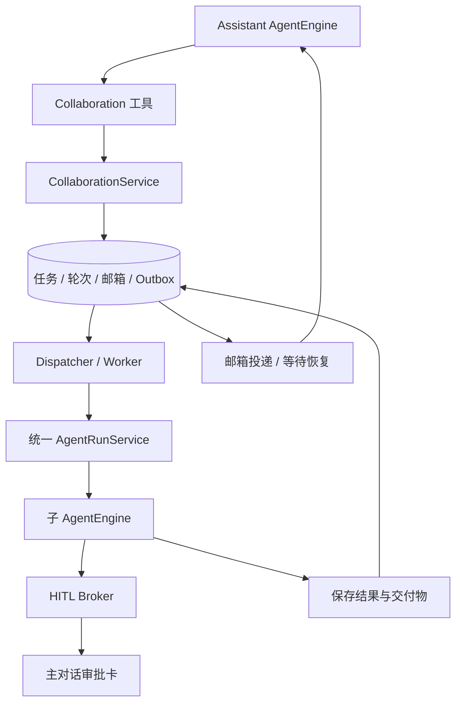

# Assistant 委派与子 Agent 协作

状态：六工具调度闭环、父等待点自动恢复及子任务审批转发已实现；剩余范围见下方交付边界。日期：2026-10-17。

## 0. 本批实现与交付边界

本批移除 `try_agent` 工具、临时试跑服务、注册、提示词和界面文案。保留且仅保留六个协作工具；不添加 `read_agent`、`close_agent`。

已接通：

- 有已登录 Web 用户身份的非共享 reasoning Agent 可作为父任务注册六工具，不限于助手。直属子实例仅注册 `send_message`，只能回报 `/root`。`spawn_agent` 省略 `agent_id` 时继承当前执行配置创建临时实例；提供时委派同工作区已有模板，保留原有模板资格限制。安装模式不开放协作。
- 子实例的 `send_message` 使用独立说明与 schema，仅包含 `target`（枚举 `/root`）和 `message`；不向子实例描述父级的下发指令流程，也不暴露父级使用的 `expected_run_id`。工具由委派运行时注入，不要求 Agent 模板预先配置；普通独立运行满足父任务身份条件时也可拆分自己的任务。主动发送取决于模型调用；工具阶段自动记录、终态结果自动投递均由运行时另行负责。
- `agent_collaborations` 有界聚合记录将任务、邮箱、结果与事件放在同一次 version CAS 内更新，兼容 PostgreSQL / SQLite。它替代下文完整目标设计的多张表，不依赖进程锁领取任务。正式迁移带活动父任务唯一索引。
- 每个协作最多三个运行中的子轮次、16 个本轮使用的实例、每实例八轮记录（跨父轮次只保留上一终态作为续跑锚点）。排队不占执行槽位，空闲实例不驻留执行器。请求去重键来自真实 tool-call 元数据；累计输入与结果有大小限制。
- `send_message` 不启动 idle；`followup_task` 在运行中作为邮件，只有未被该轮处理的追加要求才转成下一轮。结果先保存子会话的消息、工具步骤和引用，再发布事件。
- 子邮箱在交给执行器前，以当前 run/owner 租约保护的 CAS 保存 `delivered_sequence`；消息正文仍保留供快照重建。执行器 panic、丢失返回值或审批恢复启动失败时，收尾使用持久游标，只为确实未投递的 followup 创建新轮次。投递不等于执行成功，失败任务仍由父级检查结果后决定下一步。
- 引擎在轮次边界自动注入带来源的 assistant 消息；`wait_agent` 只返回通知，不消费正文。自然收尾必须等待子任务，且最新结果须参与一次模型调用；达到迭代上限时明确报错并取消剩余委派。
- 中断、父任务取消、根会话停止接口、父任务挂起后被 supersede 均有持久取消路径。旧 run/owner、过期租约、旧父消息的停止指令不能覆盖新执行；迟到成功不会把已取消任务复活。
- 父引擎在 `wait_agent` 与自然收尾等待子任务时保存安全快照、已观察游标和绝对截止时间。进程重启后，调度器扫描数据库中的结果/超时并通过 CAS 领取父租约，恢复原父消息；已完成工具不会重跑。等待超时不会因重启重新计时。运行中的父引擎仍在原等待处继续，不额外启动第二个父模型。
- queued 子任务恢复；有持久审批快照的 waiting 子任务可恢复。普通 running 或已经消费审批并进入 executing 的不确定执行转为 `needs_attention`，不自动重放副作用。用户下一次继续对话也可接管未完成协作并读取持久结果。
- 子任务审批/提问使用现有 HITL Broker，快照和当前 run 的审批关联先落库，再向父会话展示卡片。等待审批释放执行槽位；回答由后台队列消费，HTTP 不直接启动隐藏子会话。并发子任务的多个审批支持刷新恢复，保留原租户、用户、子会话和工具调用身份。
- 取消优先写入协作聚合，随后收敛关闭审批并清理快照；关闭完成前保持 cancelling，重启仍会继续清理。迟到答案不能重新排队；恢复租约被撤销后，在消费审批和执行副作用前再次检查。Broker reaper 将尚未消费的子任务 answered 状态交回调度器，executing 状态仍禁止重放。
- worker 每轮重新校验用户、当前工作空间成员资格和 Agent 可用性。默认确认/只读模式的子任务不能自行取得写授权；操作工具不被子任务继承。子会话及执行记录保留，不再像试跑一样删除。

页面事件与展示（已实现）：

- 子任务状态独立于主模型文字：持久协作组提交后发布 `collaboration_status` 全量白名单投影，以数据库 CAS version 为 revision。lease 心跳不刷新 UI；同 group 旧 revision 被丢弃，同 run 终态不能回退。模板名称与 task/run 身份分离。
- 状态包含当前任务名称、运行/等待输入/终态、工具阶段、最近主动消息及 prompt_id；不转发逐 token 思考或原始工具输入输出。主引擎 attach/recover 重放最新快照；消息历史 GET 从数据库补齐同形状的 `collaboration_status`，不依赖 Redis 存活。
- `waiting` / `resumed` 在真实审批状态变化时各投递一次给父模型；恢复从 ParentWait.After 继续消费。工具阶段只更新 UI 投影，不逐次唤醒父模型。
- 主助手中间说明使用独立 `progress` 事件，稳定事件 ID 与 `AgentStep.progress/progress_event_id` 支持持久恢复、回放去重；不写入最终正文或思考内容。
- 页面按任务持续更新列表，`wait_agent` 多次轮询合并为一个等待指示；审批显示所属子任务与实际参数，长 MCP 工具文档可展开。执行记录保留查看入口，最终正文仍由父级统一汇总。
- 审批恢复会重建 SSE 日志，其 `agent_query` 带 `resume_pending_id` 和 `resume_tool_call_id` 标识本次续跑。前端保留续跑前各 steer 分段的时间轴，重连时只重建本次续跑的后续事件；普通完整日志重放仍从空时间轴重建。
- 实时 UI 通知为尽力投递，数据库状态是恢复依据；通知投递失败不会回滚已提交工具操作，也不会导致工具重跑。
- 父 MCP 调用进入审批前检查本组当前活跃子任务已登记的审批：同服务、原生工具和语义 JSON 参数（含用户修改后的参数）返回 `delegated_call_in_progress`，不新建父审批、不调用 MCP、不借用子授权。直接与代理调用共用此检查；已结束/取消的子轮次不挡新的父调用。此保护不等于审批尚未登记时的跨进程原子防重，已有父审批恢复仍完成自身生命周期。
- 对代码区域之外合法 nonce 的孤立 `</think:…>`，通过同 event ID 的 `answer.data.replace` 回收已误分类的思考前缀；普通答案保持即时流式，标准孤立结束标签与代码字面量保留。缺失开标签时，在结束标签到达前可能短暂显示前缀；确认后实时撤回，最终思考与正文完整分开归档。16 KiB 仅限制实时回收预览，不截断最终正文。
- 2026-10-17 页面并发回归：红队评审、谜题工匠、热榜解读官三路运行；等待审批期间刷新后恢复；批准后子状态立即恢复，三份结果最终汇总且主任务结束。额外主动让父级重复调用热榜，确认命中防重、只保留子审批，日志仅一次实际 MCP 调用成功。重启、取消、迟到状态与审批恢复另由 race 回归覆盖。


本批参数以 `internal/agent/tools/collaboration.go` 为准：`spawn_agent(task_name, message, agent_id?)`，`list_agents(path_prefix?)`，`send_message/followup_task(target, message, expected_run_id?)`，`interrupt_agent(target, expected_run_id?)`，`wait_agent(timeout_ms?)`。等待默认 30 秒，范围 1–60 秒，边界外拒绝。任务默认一小时期限。

提示词与消息边界（收敛后的实现）：

- 角色提示词集中说明父子职责、进展与最终交付；工具说明仅定义调用语义与返回值。模板不再重复协作细则。
- 父级角色提示词同时集中定义主动拆分策略：开始实质工作前判断独立范围，多个有实质工作量且并行有收益的部分默认创建临时子任务；简单请求、强依赖步骤、即时阻塞工作和冲突修改保留本地，用户要求本地完成时遵从。工具说明不重复该决策策略，运行时不按关键词或任务长度强制创建子任务。
- 参考 Codex V2 的消息封装，在模型边界将持久化事件转换为 `Message Type / Sender / Run ID / Sequence / Status / Payload`。主动消息为 `MESSAGE`，追加任务为 `NEW_TASK`，子轮次结果为 `FINAL_ANSWER`（状态可能失败），恢复与审批/输入状态变更通知为 `<runtime_event>` 包裹的 JSON。审批通知携带 `type/source/task/run_id/sequence/prompt_id/prompt_kind/tool_call_id/service/tool/decision/execution_state`，工具身份和决定来自 broker 的白名单字段，不包含参数、完整请求或用户答案。`approval_resolved` 只表示审批已答复，`execution_state=queued` 只表示安排继续执行，不能视作工具成功或子任务完成；缺失/无效决定不推断。旧的纯文本通知封装为 `message` 保留，不补造审批信息。结果正文直接保留原文，不再要求模型解码嵌套 JSON；数据库事件结构不变，旧快照兼容。
- 普通工具调用后的文字不再触发额外 system 提醒。只有已生成的答复被新输入或子任务结果续跑取代时，记录 `IntermediateAnswer` 并追加一条简短状态标记；重启时从该标志恢复同一边界。
- 空响应重试和最终汇总的恢复通知通过 `Options.RuntimeNotice` 仅作用于当前模型请求，不追加到持久对话或检查点。通知位于序列尾部：Chat Completions 使用适配后的 system/developer，Responses 使用 input developer；Anthropic、Gemini、Ollama 使用明确标记来源的末尾输入，不把临时通知提升到全局系统前缀。既有系统指令、工具定义、历史和缓存断点不变；缓存命中率仍由服务端缓存寿命、路由与实际上下文决定。
- 当前 `wait_agent` 等待复用时间轴底部的活动节点、图标对齐和光影效果，待审批显示“等待你处理”；等待结束后恢复正常推理展示，完成、取消或 steer 切段时移除。成功或超时返回的等待调用不渲染历史占位文案，真实等待错误保留普通工具行供检查。
- 自然收尾仍由运行时检查活动子任务、未观察结果与取消状态；模型连续空答、重复响应或连续截断触发的协作退出返回错误，不走成功兜底，剩余子任务由运行时取消。提示词不承担审批判定、恢复资格或完成状态迁移。

本批未实现：跨子会话交付物发布、资源级共享写锁、临时模型覆盖和递归委派。只恢复明确的安全等待点，不声称恢复任意模型/工具执行点；已经发往外部系统的副作用不能通过取消撤回。没有增加模型可调用的读取、清理或审批工具。

验证：本轮补充原父消息自动恢复、已完成工具不重放、两个恢复器竞争领取、等待截止时间保留、取消与领取竞争、未消费审批跨重启、HTTP 不绕过子任务队列、旧轮次审批清理，以及父会话多审批刷新与去重测试。

验证：新增 runtime、工具、引擎和服务适配测试，覆盖双调度器并发领取、请求重放、追加消息与完成竞争、父子取消、迟到回调、过期所有权、父任务接管和权限范围。SQLite 迁移升级测试覆盖新表；PostgreSQL 提供 SQL 迁移但本机未运行 PostgreSQL 集成测试。

本轮验证记录：相关十个后端包的普通 `go test` 通过；六个包中的协作/恢复/审批定向 `-race -count=5` 通过；前端挂起恢复与审批 dock 测试 20 项通过。测试使用模拟模型和 SQLite；未运行真实模型或 PostgreSQL 实库联调。

第一阶段验证记录：相关七个包的普通 `go test` 通过；新调度 runtime 的 `-race -count=10` 及六工具/引擎/适配层定向 `-race` 重复测试通过；前端 `check-i18n` 15 项通过。测试时移除了环境里的 `LOG_FORMAT=json`（此项目将该值当作字面日志模板，否则原有日志断言读不到正文）。全 service 包 `-race` 仍有未改动测试的竞态失败：`TestTenantAPIKeyServiceAuthenticateThrottlesLastUsedUpdates`、`TestQueryTemplatesEnsureAndReplaceDoNotShareSingleflight`，以及 skill 安装相关的 `TestRegisterCatalogDoesNotMoveTheDefinitionWhenPinFails`、`TestRemovingThePinnedInstallReclaimsTheReplacedZip`、`TestUpgradeKeepsThePreviousVersionServingWhileItRuns`、`TestFailedUpgradeLeavesThePreviousVersionServing`；不能宣称全仓竞态检测通过。

### 0.1 实测问题修正（2026-10-17）

- 审批身份统一：协作记录的 `Scope.UserID` 是账户 ID，HITL 的 `UserID` 是 `Principal.StorageID()`（Web 用户为 `web_user:<ID>`）。审批登记、校验、刷新投影、重启恢复、reaper 接管及父审批关闭均在边界做显式转换，不能直接比较两个字段。旧测试手造裸 ID 掩盖了真实引擎的问题；新增测试使用真实 AgentEngine、MCPTool、Gate、SQLite prompt/snapshot 仓库及本地 HTTP MCP 服务。
- `wait_agent` 和自然结束前的等待都检查未消费的 steer。返回 `interrupted=true` 区分用户输入与超时；读取不消费，仍由引擎持久化并作为 user 消息注入。正常数据库/队列延迟下按运行时 250 ms 轮询响应，不等待原定 60 秒窗口。恢复后的父执行重新创建 SteerSink，过期父租约的安全等待点也可因持久 steer 唤醒。
- `list_agents` 增加有界 `progress`：最近工具名、调用 ID、轮次、阶段和更新时间，以及当前 `prompt_id`。工具进度覆盖保存，不累积到邮箱、不因每个工具唤醒模型；等待用户时由审批卡片展示，状态可通过 list_agents 查询，不投递模型邮箱。显式 `send_message` 继续用于中途发现和进展汇报。此处是工具可查询的运行状态，尚未增加完整子任务进度 UI。
- 父任务完成后心跳正常退出，不再取消最终事件的发送。自动恢复时若引擎初始化失败、未发出完成事件，适配层会持久化错误并补一次完成事件，避免消息永久未结束。
- 六工具定义补齐参数含义、模板查询入口、实例寻址、隔离上下文、等待/追加/取消语义和当前版本限制；不虚构 fork、模型覆盖或递归委派能力。仍未增加 read_agent、close_agent。

Codex V2 再核对：`multi_agents_v2/wait.rs` 用 input queue activity 同时监听 mailbox/steer，并在订阅时处理已存在输入；`agent/control.rs` 的 completion watcher 主要投递终态通知；`multi_agents_v2/list_agents.rs` 查询实时状态。这里对应实现为持久队列轮询、独立完成邮箱和进度快照，并未照抄其进程内通知机制。

本轮验证：十个相关后端包普通测试通过；六个包的协作/恢复定向 `-race -count=5` 通过（session 包在该筛选下无匹配用例）；最后补充修改后重跑 agent/service 全包测试通过。新增 MCP 集成测试使用真实引擎、HTTP MCP 传输及 SQLite 审批/快照持久化，模型响应仍为脚本；未验证生产模型和 PostgreSQL 环境。

手工回归建议：

1. 在 WeKnora 助手中委派一个配置了需审批 MCP 工具的推理 Agent。审批卡出现后通过；应只执行一次 MCP 操作，子任务继续，父任务收到结果并结束。重复一次选择拒绝，确认 MCP 未执行。
2. 让助手调用 `wait_agent` 等待 60 秒，在等待期间发送立即追加的 steer，确认很快进入下一轮且新输入只出现一次。另测自然收尾等待子任务期间的 steer。
3. 子任务运行时要求助手 `list_agents`，观察 running/waiting 和 progress；等待审批不占并发槽位。
4. 在审批挂起时重启后端，刷新主对话后审批；确认从原子轮次继续。另测父等待期间重启后发送 steer。
5. 停止父任务或中断子任务，再提交旧审批/等待迟到结果；确认不会再次执行或唤醒。

### 0.2 实际运行日志复核（2026-10-17 14:02–14:05）

`km_hotlist_rerun` 本次实际完成，不能据等待阶段的文字判断父任务未收尾：14:02:57 第一次审批后的 hot-articles 成功；14:03:00 模型返回新的调用 ID，再次请求相同参数，触发第二次审批；14:03:13 第二次调用成功；14:04:45 子任务完成并更新消息；14:05:06 父任务记录 complete=true、更新消息；14:05:07 事件流记录 completed。两次审批是不同工具调用，未发现调度器重放同一调用的证据。第二次调用前的模型输入已包含第一次成功结果；不能把重复调用直接归因于审批未回传。

额外确认的恢复缺陷：此前同一轮已 describe 的 show-article 在审批恢复后不在可调用目录中，造成两次 tool_ref 参数校验失败；重新 describe 后才继续。原 RememberMCPHistory 只恢复已调用的工具，遗漏了“已描述、未调用”的工具。现增加快照字段 mcp_tool_refs，保存 schema hash 引用并在恢复时重新匹配当前目录与权限，不保存凭据、不跳过停用和 schema 变化检查；父等待快照也保存同样状态。新增直接/代理工具恢复与停用、schema 变化回归测试。旧快照缺少该字段时保持旧兼容行为，可能仍需重新 describe。

截图中的 authorized=false 标签片段来自父模型的普通文本输出，不是后端审批判定；waiting 阶段提前输出的长段文字会暂时像最终答复，实际是在等待子任务。该次日志核实了最终完成事件；未因此宣称已解决模型重复调用或所有等待阶段的展示问题。

### 0.3 交付流程与输出限制（2026-10-17，14:11 实测）

第二次运行的子会话 `a54e0ea4-73ac-4626-9e68-35e66845c018` 在 14:13:17 的第 7 轮返回 `finish_reason=length`，completion=4096，回答正文 7250 字节。是模型输出上限触发，并不能据此声称隐藏子会话里还有完整结尾。界面的 500K 是上下文容量，和本轮输出预算是两个设置。现有无 sandbox 的 smart-reasoning 默认输出预算是 4096；本批不擅自修改用户配置或把上下文容量用作输出预算。

此前还存在另一处独立问题：调度器把 Answer 裁到 4000 rune，附上“全文在子会话”，却没有展开全文的闭环。本批取消答案/证据的二次裁剪，按原文持久化及投递；聚合存储仍有 32 MiB 上限，不宣称无限容量。超大交付物的资源引用仍属于后续范围。

交付规则：

- 常规审批等待仅改变持久状态、投递 UI 卡片，不唤醒父模型。旧记录里的 waiting 事件也不会因重启重新唤醒或进入模型上下文。终态结果、显式消息、用户 steer、等待超时维持原来的唤醒机制。
- 父轮次开始时如仍有活动子任务或未读结果，暂缓输出这一轮的推测性正文；通过结束屏障且无需继续处理新结果后才可交付。子结果已处理后的最终汇总仍可正常流式输出。中间步骤保留用于审计。
- 根/子引擎在新执行和审批恢复时都有明确角色约束：交付实际内容，区分历史与当前运行，不复述旧审批状态，不重复已成功工具调用，不用执行清单替代正文。
- 子回答达到输出上限时，仅在剩余轮数允许的情况下给一次无工具的精简重写机会，用已取到的证据覆盖各节；不提高用户预算，不循环续写，不重复副作用。这是 WeKnora 的受限恢复策略，不声称来自 Codex。重写仍截断或预算耗尽后的合成回答截断，结果带 `truncated=true`、终态 failed 和原因，保留已有正文，不冒充完整成功。父级可据此决定有针对性的 followup。

Codex 对照的具体边界：固定版本的 [session_prefix.rs](https://github.com/openai/codex/blob/3b8f43a06bb3105e81406b35ff69f94977d18ae4/codex-rs/core/src/session_prefix.rs#L20) 对 Completed(Some(message)) 直接复制回答，截断限额仅用于错误文本；[responses.rs](https://github.com/openai/codex/blob/3b8f43a06bb3105e81406b35ff69f94977d18ae4/codex-rs/codex-api/src/sse/responses.rs#L420) 将非 interrupted/content_filter 的 incomplete 转成 ResponseIncomplete 错误。不能由此推断所有提供商、上下文压缩或工具输出都完全不截断。

新增回归涵盖：超过 4000 字的答案经持久化/重建运行时后完整投递；旧 waiting 事件不会唤醒，真实完成事件仍唤醒；父任务在等待时不展示未确认正文；真实引擎 + 本地 HTTP MCP 的批准/拒绝/取消/重启，以及一次重写成功、再次截断、轮数耗尽合成截断，确保工具副作用不重复。

本批验证：相关 10 个后端包普通测试通过，runtime/engine/service 协作定向竞态测试重复 3 次通过。使用脚本模型与本地 HTTP MCP；没有用真实模型重新执行用户任务，未修改运行中服务或用户的输出预算配置。

### 0.4 中途报告与最终交付（2026-10-17，14:25 实测）

根消息 `8ab152d6-1e43-4502-bca8-610165da6b23` 在委派参数中自行要求「分两条消息」：子会话 `57403813-ca94-4840-a22e-1bdd48ee72bc` 第一轮返回榜单及前两篇，父任务第 6 轮复述正文并调用 followup_task；第二轮返回后两篇及结尾。主任务第 8 轮已有两份结果，无上下文压缩，finish=stop，completion=2210，却只交付后半段并称为完整结果。并非 4000 字裁剪或输出预算耗尽。

原因是 UI 将附带工具调用的正文重分类为中间步骤，而模型上下文没有明确说明这部分不属于最终交付。主 Agent 把自己前一轮的长篇正文当成用户已收到的「上一条」，最终答复依赖折叠步骤才能完整。

本批统一约定：执行中只给一两句进展，完整表格/章节留到最终正文；单个子执行轮次只产生一份最终答复，跨轮结果由父级合并。早期实现曾在附带正文的工具轮及续跑答复后注入 runtime delivery state；现已收敛为仅在答复被新输入续跑取代时追加简短状态标记。普通工具步骤通过原生 tool-call 结构区分，汇总规则仅保留在角色提示词。保留原 provider 消息、工具调用 ID 及 reasoning；快照根据 IntermediateAnswer 重建续跑边界，子结果通过独立消息封装交给父模型。没有通过重跑整个 Agent、裁剪正文或将工具步骤拼成最终回答来掩盖问题。

官方 [assistant phase 文档](https://developers.openai.com/api/docs/guides/deployment-checklist#set-up-the-assistant-phase-parameter) 区分 commentary 与 final_answer，并要求回传历史保留 phase；当前 Chat Completions 兼容链路未接通原生 phase，本批使用运行时语义标记与角色提示，不能宣称已经接入 Codex 的完整协议或强制保证模型语义质量。

子任务通过 send_message 主动报告关键发现/阻塞，父级等待立即收到通知、下一轮注入正文；自动工具进度仅更新 list_agents 查询状态，不逐步推送全部工具输出。回归验证关键消息在子任务仍 running 时可唤醒父级，取消后拒绝迟到消息。

新增测试覆盖两轮子结果同时保留在父上下文、正文与中间步骤的交付边界，以及快照恢复后该边界仍存在；使用脚本模型，不能替代真实模型对最终报告完整性的验收。

## 1. 核实结果与设计依据

用户提供的 `collaboration` 定义包含 `spawn_agent`、`list_agents`、`send_message`、`followup_task`、`interrupt_agent`、`wait_agent`。六个工具的名称、参数和核心语义与本次设计会话实际暴露的子 Agent 接口一致。可以确认这是本会话这一类子 Agent 协作接口的定义；无法仅凭文本确认导出来源、版本或其是否为所有 Codex 客户端的公开稳定 API。

进一步克隆官方仓库后，确认这六个工具对应 **MultiAgentV2** 的实现。检查仓库为 `https://github.com/openai/codex.git`，固定提交为 [`3b8f43a06bb3105e81406b35ff69f94977d18ae4`](https://github.com/openai/codex/commit/3b8f43a06bb3105e81406b35ff69f94977d18ae4)，提交时间为 2026-10-17 02:27:35 UTC。本次只读检出的目录为 `/tmp/codex-source-audit.WNlDZa/codex`；临时目录不作为长期证据，以下链接均固定到该提交。实际工具暴露还受配置、模型元数据和版本影响，不声称文本逐字段适用于所有客户端。

官方 [Codex App Server 文档](https://learn.chatgpt.com/docs/app-server#api-overview) 另有 thread 创建、恢复、分叉、状态事件，以及 turn 启动、追加输入和中断接口。这支持“实例和执行轮次分离”的设计方向，但该文档不能证明用户提供的六个工具就是公开 App Server 协议。粘贴文本的 `encrypted`、`strict` 属于其 schema 元数据，本设计不据此推断加密方式，也不照搬。

当前仓库的基础：

| 已有实现 | 可以复用什么 | 尚需补充什么 |
|---|---|---|
| 原试跑入口（本批删除） | 解析 Agent、运行 AgentQA、收集结果的经验 | 由六工具和持久子会话统一替代，不再保留试跑用途 |
| `internal/handler/session/qa.go`、`steer.go` | 后台运行、单会话执行互斥、停止、追加指令、后续轮次 | 提取不依赖 Gin/SSE 的统一运行入口 |
| `internal/agent/hitl`、`internal/agent/resume.go` | 审批持久化、租约、快照、恢复 | 子任务审批的主对话展示；等待子 Agent 的独立恢复原因 |
| `internal/types/interfaces/stream_manager.go` | 事件流、运行标记、用户消息投递 | 持久化的 Agent 邮箱与完成通知 |
| `internal/types/message_artifact.go` | 交付物记录和下载入口 | 跨子会话的受控引用、结果版本关联 |
| `internal/types/interfaces/task_queue.go`、`task_enqueuer.go` | 排队、领取、重试的已有基础设施 | Agent 执行的数据库所有权和不可盲目重放规则 |

现有 `Session.ParentSessionID` 表达会话分叉来源，不复用为委派关系；现有业务队列任务也不直接充当用户看到的子 Agent 实例。

### 1.1 Codex 源码对照结论

| 源码事实 | 固定版本证据 | 对本设计的影响 |
|---|---|---|
| V2 定义了上述六个工具；V1 另有关闭工具 | [multi_agents_spec.rs](https://github.com/openai/codex/blob/3b8f43a06bb3105e81406b35ff69f94977d18ae4/codex-rs/core/src/tools/handlers/multi_agents_spec.rs#L204) | 我们保留 V2 的六工具面；不能将“V2 不暴露关闭工具”说成“Codex 从未实现关闭工具” |
| 消息区分 QueueOnly 与 TriggerTurn，followup 禁止指向 root | [control/api.rs](https://github.com/openai/codex/blob/3b8f43a06bb3105e81406b35ff69f94977d18ae4/codex-rs/core/src/agent/control/api.rs#L100) | 普通消息不启动空闲实例，返工启动子轮次；子 Agent 不能凭消息启动新的根任务 |
| wait 订阅输入活动后检查已有输入；只接受 timeout_ms，返回 message/timed_out，不返回正文 | [v2/wait.rs](https://github.com/openai/codex/blob/3b8f43a06bb3105e81406b35ff69f94977d18ae4/codex-rs/core/src/tools/handlers/multi_agents_v2/wait.rs#L44)、[input_queue.rs](https://github.com/openai/codex/blob/3b8f43a06bb3105e81406b35ff69f94977d18ae4/codex-rs/core/src/session/input_queue.rs#L150) | 第一版 wait 同样仅保留 timeout_ms；游标由运行时管理，避免过滤和全局游标交错导致漏读 |
| 子结果以 trigger_turn=false 投递给直接父级，投递代码明确为 best effort | [completion.rs](https://github.com/openai/codex/blob/3b8f43a06bb3105e81406b35ff69f94977d18ae4/codex-rs/core/src/agent/control/completion.rs#L1) | 数据库/outbox 可靠投递及根任务继续执行属于 WeKnora 的新增保证，不能宣称已由 Codex 源码验证 |
| 空闲线程有 TriggerTurn 邮件才启动；存在 durable sleep 时，普通邮件也可唤醒 | [tasks/mod.rs](https://github.com/openai/codex/blob/3b8f43a06bb3105e81406b35ff69f94977d18ae4/codex-rs/core/src/tasks/mod.rs#L442) | 不能绝对化为“所有完成消息永不唤醒”；WeKnora 用明确的等待/继续执行记录决定是否唤醒 |
| 中断拒绝 root/self，返回之前的状态；不会为中断而加载已卸载实例 | [interrupt.rs](https://github.com/openai/codex/blob/3b8f43a06bb3105e81406b35ff69f94977d18ae4/codex-rs/core/src/agent/control/interrupt.rs#L1) | 区分中断请求已接受和执行已退出；不靠读取旧状态判断已停止 |
| 执行容量与驻留容量分开；空闲运行时可被卸载，保留/转移状态和邮箱 | [execution.rs](https://github.com/openai/codex/blob/3b8f43a06bb3105e81406b35ff69f94977d18ae4/codex-rs/core/src/agent/control/execution.rs#L1)、[residency.rs](https://github.com/openai/codex/blob/3b8f43a06bb3105e81406b35ff69f94977d18ae4/codex-rs/core/src/agent/control/residency.rs#L35) | 实例身份、驻留资源、执行槽位分别管理；WeKnora 的持久化恢复仍需自己实现 |
| Agent 消息具有独立来源类型，呈现为 assistant 角色片段 | [inter_agent_message.rs](https://github.com/openai/codex/blob/3b8f43a06bb3105e81406b35ff69f94977d18ae4/codex-rs/core/src/context/inter_agent_message.rs#L46) | 不复用将内容视作用户授权的追加指令路径 |

已阅读相关测试而未执行 Rust 测试：`multi_agents_tests.rs` 中的 wait 只返回通知、已有邮件立即唤醒、followup 每轮通知、拒绝对 root followup、被中断轮次不发送完成通知；`core/tests/suite/agent_control_tests.rs` 的 `host_mailbox_notifies_waiting_agent_and_delivers_once` 验证正文独立投递且只出现一次。Codex 此版本的中断不产生完成通知，WeKnora 则明确增加独立的 `run.interrupted` 状态事件，以便持久任务管理不会一直等待成功结果。这是产品差异。

## 2. 目标与第一版边界

用户向 reasoning Agent 提出目标后，该 Agent 能创建继承自身能力的临时子任务，或选择已配置的 Agent 委派任务，并行分派工作，补充要求，等待结果，处理人工交互，要求返工，最终交付。刷新页面或恢复服务后，任务状态和已经完成的结果仍可查询。

当前采用一个父 Agent 协调多个直属子 Agent：

- 省略 `agent_id`：使用父任务当轮的生效配置快照，包括实际选用模型、提示词、知识库/文档/标签范围、MCP、Skills、沙箱配置和实际工具集合；不写入新的 `CustomAgent` 记录。
- 提供 `agent_id`：使用已有 `CustomAgent` 模板快照，经授权范围裁剪后运行。
- 只支持当前工作空间内可使用的 smart-reasoning Agent。共享跨租户执行不开放。模板模式保留内部管理模板限制；继承模式按父任务的运行权限工作，不因父任务是普通 Agent 或内置助手而增加专用分支。
- 子 Agent 只能向父级回报，不再创建子 Agent，不直接指挥兄弟节点。后续可以在相同模型上开放层级和同级协作。
- 面向模型只提供原来的六个协作工具；结果读取、上下文投递和实例清理由运行时负责，不增加读取或关闭实例的工具。
- 默认最多 3 个子 Agent 同时执行，为协调者保留执行容量；等待审批或子任务时释放计算槽位。
- 临时子任务不能自定义角色或覆盖模型，也不提供通用 DAG 编辑器、任意执行点无损恢复、定时调度。
- 首版默认独立沙箱。共享知识库/Wiki 写入要有资源范围与冲突控制；不默认共享可写宿主项目目录。

### 临时子任务的持久化与范围

- 配置快照来自服务端运行上下文，工具调用不能提交模型、权限或配置快照。MCP 的 `all` 在父任务初始化时解析成具体服务集合；子执行注册的工具再与父任务实际工具集合取交集。
- 用户、工作区成员身份和来源 Agent 在每轮重新授权；知识库读取权限、可写范围和工作区审批上限重新检查。Skills 只保存已授权名称，运行时重新加载可用内容和凭证，不持久化技能环境变量。
- 临时子任务仍使用独立会话与沙箱，不复制父聊天历史、附件路径或未完成的调用。父级在 `message` 中提供完整任务与必要背景。`followup_task` 保留同一子会话和配置；审批恢复继续同一执行轮次。
- 两种模式共用排队、邮箱、等待、取消、审批、结果和产物交接；临时任务界面显示 `task_name`，不把它伪装成一个新保存的模板。
- 回归覆盖临时/模板三路混合并发、重启后配置恢复、同实例追加任务、普通父 Agent 唤醒、权限收紧和工具范围不扩张，以及两种模式下真实 MCP 审批的批准、拒绝、取消和重启恢复。

## 3. 三种身份与生命周期

必须区分：

1. **Agent 配置 `agent_id`**：模板委派时的现有 `CustomAgent` ID，可以同时实例化多次；临时实例的该字段为空，来源和生效配置保存在私有快照中。
2. **协作实例 `member_id`**：某次用户任务里的子 Agent，拥有持久子会话和邮箱；一次工作完成后仍可接收返工。
3. **执行轮次 `run_id`**：实例的一次执行。启动、返工会产生新轮次；审批恢复继续原轮次。

另建 `collaboration_id` 作为一次用户目标的边界，关联根会话和发起消息。同一根会话的不同任务不能仅凭 session ID 混在一起。

实例状态：`open → closed`，由运行时管理。执行情况由当前轮次表达；没有活跃轮次的 open 实例为 idle。单个子轮次结束后，实例仍可供 followup；整个协作结束或被取消后统一关闭。驻留状态 `loaded / unloaded` 独立于实例状态：unloaded 的 open 实例可在 followup 时重新加载，不能误判为 closed。

轮次状态：

```text
queued → running → succeeded | failed | interrupted
                ↘ awaiting_input → running
                ↘ awaiting_children → running    （协调者）
queued/running/awaiting_* → cancelling → cancelled
running → needs_attention                        （副作用结果未知等）
```

- `succeeded` 只表示执行结束并保存结果，不等于交付质量已通过验收。第一版不引入机器可判定的 accepted/rejected 状态；父级依据结果决定返工或交付，运行时只记录结果版本、投递、参与处理的父轮次和返工关联。
- `interrupt_agent` 停止当前轮次，保留实例及历史，可再 followup；拒绝 root/self 目标，对 idle 实例返回无活跃轮次而不重新加载。对挂起轮次也要取消其 prompt/wait 恢复资格，迟到审批不能复活被中断轮次。退出确认前不能在同一实例启动下一轮写操作。
- 实例关闭和资源清理由运行时统一执行；关闭后不能再自动启动，仍在执行的轮次必须先取消并确认退出。实例关闭不删除历史和交付物。
- 用户“停止整个任务”将协作置为 cancelling，取消所有排队/运行/挂起的轮次，关闭唤醒资格；不会回滚已经发生的修改。
- 每个取消请求携带 generation。晚到的事件仍可记入审计，但不能重新启动已取消的任务。

## 4. 面向模型的工具

仅保留原定义的六个工具，不增加读取或关闭工具。以下是它们在 WeKnora 中的建议参数和语义，参数采用严格 schema 校验；参数适配不意味着与原定义逐字段兼容。

| 工具 | 主要参数 | 语义和返回 |
|---|---|---|
| `spawn_agent` | `agent_id, task_name, message, context_mode?, resource_refs?, expected_output?, limits?` | 创建实例、子会话、首轮和入队事件，立即返回 `member_id, run_id, task_path, status`；不等待完成 |
| `list_agents` | `path_prefix?, include_closed?, cursor?` | 返回当前协作内实例和当前轮次摘要、阻塞原因、未读事件数、交付物摘要；不等于列出 Agent 配置 |
| `send_message` | `target, message, expected_run_id?` | 持久投递消息；运行中在安全边界接收，idle 时保留在邮箱，不启动新轮次；返回 `event_id, delivery_state` |
| `followup_task` | `target, message, expected_run_id?` | idle 时创建新轮次；running 时作为追加要求投递；挂起时保存要求但不自动批准审批。返工原因写在 message 中，运行时关联当时的结果版本；返回实际 `run_id` 和投递状态 |
| `interrupt_agent` | `target, expected_run_id` | 中断指定轮次；返回原状态和 `interrupt_requested`，终止确认由后续事件表达 |
| `wait_agent` | `timeout_ms?` | 等待当前协调者邮箱或输入变化，返回唤醒/超时/用户输入中断通知；不接受 targets 或模型提供的游标。正文及来源由运行时读取并投递 |

Agent 选择先复用 `agent.list / agent.get`，补充返回 `can_delegate`、不可运行原因及能力摘要；暂不新增单独的 Agent 搜索体系。

`target` 优先用 `member_id`，也可用同一协作内的路径。`task_name` 在同一父实例下唯一；相同请求重放返回原实例，不同请求使用重名则报冲突，不静默复用。所有工具的身份、租户、协作根、父实例均由运行上下文注入，模型不能指定。

保留原定义中 `wait_agent` 的职责：它负责等待并报告更新，正文由运行时从持久邮箱和结果记录读取，在安全边界另行投递。未调用 wait 时，运行中的父级也能收到结果。工具返回的更新标记不代表正文已被消费；只有正文及其来源已持久写入父级上下文，才推进投递游标。两条路径使用同一套去重记录。

wait 采用 wait-any 语义：任一相关实例有新消息、终态或待用户处理状态即返回；是否已经收齐所有结果由协调者判断。默认等待 30 秒，最小 10 秒、最大 1 小时，均为服务端配置；低于最小值钳制，高于最大值拒绝，不默认将 0 解释成立即读取。请求等待时长是此次 wait 的总截止时间，挂起和重启不能重置；超过运行时短等待阈值则写快照挂起，数据库定时扫描在 deadline 到达时也必须触发恢复，不能只靠子事件唤醒。超时不取消子任务。

示例：

```json
{
  "agent_id": "existing-market-agent-id",
  "task_name": "market_analysis",
  "message": "分析提供的市场材料，区分事实、推断和缺失数据。",
  "context_mode": "brief",
  "resource_refs": [{"kind": "knowledge", "id": "authorized-document-id"}],
  "expected_output": "给出分析结论、证据引用和待核实事项；不修改原文。"
}
```

实例 ID 不混用现有 Agent 配置 ID。模型默认使用目标 Agent 保存的配置；第一版不提供任意模型 override。

## 5. 上下文、权限与人工交互

### 5.1 上下文传递

- 默认 `context_mode=brief`：任务说明、父级明确提供的必要背景、经检查的资源引用、交付要求。
- `none`：只传任务与明确引用，不继承父历史。
- `all`：后续版本开放授权范围内的父对话快照；不复制父级系统提示词、工具授权或未完成的 tool-call 配对。第一版遇到该参数应明确拒绝。
- 创建时冻结历史边界和 Agent 配置版本/快照；快照保存凭证引用而非密钥正文。运行中修改配置不静默改变已有实例。授权撤回在每次恢复和敏感操作前重新检查。
- 不透传过期 URL、父级 cN/dN 等临时引用句柄；转换为稳定资源 ID，在子会话重新解析。
- 子结果通过 artifact/document ID 交接；父级显式选择再传给下一子 Agent，重新授权，不直接共享全部上下文或整个文件系统。

### 5.2 授权

有效资源/动作权限取“用户当前权限 ∩ 工作空间策略 ∩ 本次任务授权范围 ∩ 目标 Agent 允许范围”。父 assistant 自身未安装某个专业工具，不代表子 Agent 也不能使用；因此不能简单对父子工具名称取交集。

为子执行生成 DelegationContext，记录 root/member/run、用户、执行租户、资源范围、允许动作、审批策略和预算。所有工具入口、MCP 调用和沙箱能力由运行时执行约束，不能只写进提示词。范围未明确或无法执行约束的写能力不开放，标记需要授权/不支持。

第一版在注册时限制仅内置 assistant 能创建和控制子实例；子实例只有向父级发送消息的能力。不可通过子 Agent 获得管理目录、其他用户会话或宿主目录的额外权限。

Agent 消息保存 `source=agent`、发送者实例和轮次，是协作材料，不是用户授权。现有 `drainSteerMessages` 把内容写成 user 消息，不能直接原样复用于子 Agent 回报；新增专用 mailbox 注入路径和有来源的消息序列化，不能伪装成用户发言或提升为系统指令。

### 5.3 审批与提问

子 Agent 的 ask_user、工具审批、OAuth 仍复用 HITL Broker。请求归属保持在子会话/子消息，主对话只展示带 Agent 名称、任务与操作范围的代理卡片。回答通过服务端验证根任务到子 prompt 的归属、用户身份及当前状态后路由；不能为了方便把 prompt 的 session_id 改成父会话。

用户审批只允许该操作/明确范围，assistant 不能代批，也不能把拒绝转换为再次委派。其他子任务可以继续，父级能看到该任务在等待用户。停止根任务时同时关闭未决 prompt；晚到回答不能恢复任务。

## 6. 数据与执行架构

建议新增以下模型；JSON 字段保存可演进载荷，关系、状态、游标、版本与索引使用独立列：

| 模型 | 关键内容 |
|---|---|
| `agent_collaborations` | id、tenant/user、root_session、origin_message、status、generation、continuation_generation、pending_result_runs、预算和使用量 |
| `agent_members` | id、collaboration、parent_member、agent_id、child_session、task_name/path、config_snapshot、授权范围、open/closed、current_run_id |
| `agent_runs` | id、member、trigger_event、assistant_message、state、owner_token、lease、version、输入、结果引用、usage、error、latest_model_input_sequence |
| `agent_mailbox_events` | recipient、sender、kind、sequence、run_id、payload、dedup_key、delivered_to_run、handled_by_run；关联持久消息/快照位置 |
| `agent_waits` | run、cursor、deadline、snapshot_ref、恢复阶段、waiting/resuming 状态及版本 |
| `agent_dispatch_outbox` | execute/resume/notify/cancel 事件、去重键、重试和已发送状态 |

关键约束：`(collaboration_id, parent_member_id, task_name)` 唯一；`(member_id, trigger_event_id)` 唯一；`(recipient_id, sequence)` 和投递 dedup_key 唯一；同一 run 只有一个有效 wait。根协调者同样有 member 记录，保证路径和邮箱一致。通过锁定 member 行并 CAS 更新 current_run_id，保证每个实例至多一个未结束轮次；根会话仍服从现有会话级互斥。所有约束须同时在 PostgreSQL 与 SQLite 实现，不能依赖只在 PostgreSQL 可用的锁语法。

子会话新增服务端专用 kind；普通会话列表默认不混入，任务卡可进入详情。用户可以查看其完整过程，执行完成不删除。删除根任务时先停止执行，再按会话/交付物保留规则清理。运行时关闭实例、释放资源与删除持久记录是不同操作。



从现有 session handler 中提取 `AgentRunService.Start/Resume/Interrupt` 及运行准备、结果持久化、交付物收集能力。HTTP handler、任务 worker、HITL 恢复共用服务；不在协作服务中模拟 HTTP 请求，也不只直接调用 AgentQA 而遗漏 handler 的结果处理。

任务创建、首轮、触发事件与 outbox 同一事务提交。Dispatcher 事务提交后入队；asynq/进程内 executor 只负责唤起执行，数据库 CAS、lease 和 owner token 决定谁能运行。无 Redis 模式也扫描未发送 outbox 和未领取工作，不能依赖进程内 goroutine 保证重启恢复。

## 7. 可靠投递与父级继续执行

### 7.1 消息不会自动变成新的任务

`send_message` 只写邮箱，不产生新轮次。运行中在下一轮模型调用前及自然结束前读取；idle 时留待下一次启动。`followup_task` 将“投递要求”和“确保有消费者”在事务中完成：要么交给当前轮次，要么在当前轮次结束后创建一个新轮次，不能落在退出竞态中丢失。

消息投递和 followup 路由在锁定 member/current_run 后确定。如果 `expected_run_id` 已变化，返回冲突，不把针对旧结果的返工投给新轮次。挂起期间只追加消息不等于恢复审批；排队、暂停和取消中的实例分别返回明确的 queued、paused 或 rejected 状态。

客户端请求 ID / 父工具调用 ID 映射为服务端去重键；模型重复输出同名工具但不同调用 ID 并不天然幂等，仍需重名、当前轮次和业务范围约束。`expected_run_id` 不匹配时返回冲突，不中断或覆盖后来的执行。

邮箱事件按接收者分配提交有序的序号，不用“全局自增 ID 大小”等同提交顺序。持久化上下文注入记录与游标推进应原子完成；刷新、崩溃后可回放相同事件，但不能重复写入模型历史。目标隔离在同一 collaboration，分页游标绑定接收者及筛选条件。

必须区分“进入持久上下文”和“父级已处理”：记录 `delivered_to_run` 后进程可能尚未调用模型。只有后续模型请求确实包含该事件，且父轮次完成或提交相关后续操作，才记录 `handled_by_run`。崩溃恢复时，未处理事件从持久消息或快照重新参与上下文构建，不能因投递游标已推进而丢弃。重新关联新父轮次不重复插入原消息。

### 7.2 等待是运行状态

短等待可在内存中等待事件；超过短等待阈值则写入 wait、引擎快照及已消费游标，置 `awaiting_children` 并释放计算资源。持久订阅先于再次检查事件，消除“检查后、订阅前完成”的丢唤醒窗口。

当前 `AgentEngine.Resume` 要求 answered AgentPrompt，`AgentRunSuspension` 也绑定 prompt_id。应抽出通用恢复载荷（`human_prompt / agent_wait`）及公共快照恢复逻辑，保留旧 HITL 数据兼容；不要创建伪造的“已批准 prompt”恢复 wait。wait 恢复时完成原 wait 工具调用并返回更新通知，运行时持久投递对应正文，再继续同一轮次。

快照必须同时覆盖 `pending_tool` 与 `between_rounds` 两种恢复阶段：显式 wait 恢复时补齐原工具结果；父级自然结束检查发现尚有子工作时，在轮次边界保存继续执行点，不伪造一个不存在的 wait 工具调用。现有 RunSnapshot 的 BlockedIndex/PendingRound 结构只覆盖前者，需要版本化扩展。等待阶段消息、步骤、事件游标和状态的提交要有一致的恢复协议，不能只保存一个 waiting 标记。

子轮次结果、交付物记录、终态、父邮箱事件及 outbox 在可提交的事务边界内发布；文件对象先写入，数据库引用后提交，孤立文件异步清理。只有可读取的结果提交后才通知“已完成”。

父级处理规则：

| 父级状态 | 子事件处理 |
|---|---|
| running | 写邮箱，在安全边界注入，不开第二个并行父轮次 |
| awaiting_children | CAS 领取 wait，合并已到事件，恢复一次 |
| awaiting_input | 保存事件，优先保留未决用户交互，不因子完成绕过它 |
| active 但当前轮次已结束 | 仅运行时签发的完成/失败/中断/需用户输入事件，在匹配 continuation_generation 且关联 pending_result_runs 时可创建去重的协调后续轮次；普通 send_message 只排队 |
| paused/needs_attention/failed/cancelling/cancelled/completed | 保存状态和结果，不自动唤醒 |

第一次 spawn 时，运行时为本次目标建立有限的继续执行资格；每次 spawn/followup 原子更新 pending_result_runs。资格受 generation、用户取消/暂停和总预算限制，只允许继续原目标，不允许子消息修改目标或额度。后台恢复由系统事件触发，不能通过在普通消息正文写“已完成”伪造。子审批首次进入待输入状态可通知父级一次，但不能因此反复启动父模型。

协作仍有未决子任务时，父级普通回复可结束当前轮次，但不能把整个目标标为完成。父级正常产生最终回答时，运行时在落库前进行终结检查：所有子轮次已退出、无未决 prompt/返工/待处理终态事件，且最后一次模型请求包含当前必需结果。若结果在模型请求之后到达，必须再给父级一轮处理机会；只“已经注入上下文”不够。检查通过后记录最终交付并统一关闭实例。这里判定的是执行流程结束，不是机器证明答案质量合格；失败分支仍需如实汇报。

父模型异常退出、被内容过滤、预算耗尽或用户中断不能走正常最终回答终结流程，分别保留 failed/needs_attention/paused/cancelled 等原因。与新子事件竞争时用协作锁和版本 CAS 决定继续或完成，不能先发布“任务已完成”再补查状态。流式文本可先展示，但最终完成标记必须等待该检查。

用户新消息、停止、回溯与系统唤醒共用会话互斥及 generation 检查。用户输入优先；新消息进入运行时更新上下文，回溯/删除使旧恢复资格失效。正常新消息不隐式取消所有旧任务；后台结果注入须标明目标，避免当作新问题的答案。

### 7.3 运行时读取与清理

结果读取使用内部服务接口，不注册为模型工具。子轮次完成后，运行时按 `member_id + run_id + result_version` 读取已提交结果、引用和交付物，生成带来源的父级上下文材料。短结果完整投递，长结果投递摘要、明确的截断标记及稳定资源引用；不能静默丢弃错误、阻塞或未完成项。完整文本可沿用已有的 `message.list` 操作读取所属子会话，文档/文件沿用现有资源读取能力；接入时必须验证新增子会话 kind 的授权与结果展开能力。不能只给出父级实际无工具可读的句柄；无法展开时应保留可交付原件并明确限制。用户查看完整过程沿用子会话详情。

清理遵循以下规则：

- 子轮次结束后释放执行槽位和临时执行资源，保留实例、会话及可恢复的工作区状态，允许后续返工。
- 根任务完成时，在同一终结事务中校验 generation、无其他活跃/挂起轮次及未决交互、无待处理结果和 followup，并结束当前父轮次、保存最终交付与处理记录、关闭实例和唤醒资格。检查不能把即将结束的父轮次自身算成阻塞项。与并发 followup 争用同一协作状态锁，避免清理后仍入队。
- 用户取消或删除时先进入 cancelling、阻止新工作并取消未决轮次和 prompt；待执行者退出后关闭实例。外部调用结果未知则保留待核实状态与审计信息，不宣称已回滚。
- 沙箱、租约、临时文件的释放通过幂等清理任务完成；清理失败可重试，不重复运行 Agent。工作区需要恢复的内容先完成持久化，再释放资源。
- 暂停不会关闭实例；恢复仍受当前权限和预算检查。关闭后的旧实例不能被消息或 followup 隐式重新打开。
- 历史、结果和交付物按现有保留/删除规则处理，不随计算资源清理一并删除。

普通空闲卸载不同于根任务终结：卸载持有实例驻留租约，先禁止并发投递进入将被销毁的内存队列，再保存会话/工作区状态和未投递邮件，最后释放资源。send_message 可以直接写数据库邮箱而不加载实例；followup 先领取加载/执行资格再恢复。任务树关闭后不允许这种懒加载。分别配置最大实例数、最大驻留数和最大执行数，不能只限制并发模型请求而保留无限空闲沙箱。

## 8. 恢复、预算与写冲突

- 排队但未执行的轮次可以重新领取；审批/子任务等待可从已保存快照恢复。
- 普通执行中进程崩溃不承诺任意点无损恢复。只读且可重放的轮次按策略重试；存在结果未知的写调用则置 `needs_attention`，保留证据并核实外部状态，不自动整轮重跑。
- 租约过期后旧 owner 不得提交新结果或启动下一工具调用；外部写操作若不支持幂等键/版本条件，不能仅靠 fencing 保证恰好一次。
- 同时限制工作空间、用户、整个协作和单轮次的执行并发、最大实例数、时间、token 与模型调用预算。创建时做准入，运行前预留额度，结束后结算；子调用必须汇总到根任务。
- `max_completion_tokens` 只是单次模型输出限制，不能当作整个任务预算。供应商计费不精确或中断时，保留估算与实际值；预算不足不再分派新调用。
- 并发槽位只计算实际执行，不让正在等待子任务的父级占满全部槽位。多租户公平排队，不在模型工具调用内无限阻塞等槽位。
- 默认隔离沙箱。Wiki/文档写入按资源 ID 申请执行租约，并用版本条件/OCC 检测来自普通用户的并发编辑；仅有模型约定或协作内部锁不够。无法提供写入范围和冲突控制的能力暂不纳入并行委派。

## 9. 前端、结果与验收

主对话显示一组持久子任务卡片：Agent 名称、任务、运行状态、阻塞原因、结果摘要、交付物、查看过程、追加要求、停止。waiting 与 idle 区分，不能全部显示“运行中”。系统恢复产生的消息带“继续处理任务”来源，不伪造成用户消息。

结果建议结构：`run_id, result_version, status, summary, artifact_refs, evidence_refs, changes, unresolved_items, usage, error`。完整内容保存在子会话/交付物中，运行时负责读取并投递父级所需上下文。

assistant 检查运行时投递的结果与交付要求，不合格时用 followup 的 message 说明返工原因，运行时关联被修订的结果版本并产生新轮次。最终答案沿用现有普通模型输出，不要求额外的结构化“验收成功”协议，也不增加 acceptance 元数据或 review 参数。运行时记录哪些版本进入了最终父轮次及后续返工，但不自动推断语义验收通过。最终回复明确汇报交付物、实际修改、失败和未完成部分，不用“工具成功”替代任务验收。

## 10. 实施顺序与验收

1. **运行基础**：提取 AgentRunService，建立 collaboration/member/run、授权上下文、基本预算准入、数据库 CAS/outbox、子会话及结果持久化。验证单任务创建、执行、运行时读取、中断和返工；模型只注册六个协作工具。
2. **协作闭环**：接入邮箱、增量游标、自然结束前检查、wait 挂起恢复、父级后续轮次、子审批转交、运行时终结/清理和主对话卡片。此阶段完成后才作为可用功能开放。
3. **可靠性与并发**：完善预算结算、资源写冲突、失联回收、多副本/Lite 重启恢复及故障注入测试；通过对应验证后再开放并发写能力。
4. **后续扩展**：共享 Agent、上下文 all、临时角色、多层委派和同级通信；每项独立设计授权与限额，不改变上述身份和生命周期。

核心验收场景：

- 同一 Agent 配置并行创建两个实例，历史、沙箱、结果互不混淆。
- spawn 响应丢失后重试只产生一个实例；重复 followup 不产生两个轮次。
- send_message 到 idle 不启动模型；followup 到 idle 恰好启动一次，到 finishing 的竞态也不丢消息。
- 两个子任务完成事件同时到达、或事件早于 wait 注册，只恢复一个父轮次且不漏结果。
- wait 在持久挂起后没有任何子事件也会按原 deadline 恢复并报告超时；重启不重置超时，也不取消仍在运行的子任务。
- 主对话刷新、Redis 通知丢失后可从数据库恢复状态与消息；Lite 重启仍能领取待执行工作。
- 子任务审批等待时另一个继续；主对话回答后恢复正确子轮次；重复/过期答案不执行写操作。
- 运行中停止整个任务，迟到完成或审批不会重新唤醒；已发生修改被如实保留和展示。
- 写操作后、结果落库前崩溃，标记结果待核实，不盲目重复执行。
- 子消息不具备用户授权身份，跨租户/其他任务 target 被拒绝，授权撤回在恢复时生效。
- 不合格交付物可以返工，运行时投递新版后父级再验收；最终可下载文件与验收结果一致。
- 模型工具列表恰好包含六个协作工具；wait 仅通知更新，正文自动投递，wait 与后台投递不重复注入结果。
- 子轮次结束后仍可 followup；根任务结束后运行时统一关闭，晚到 followup 不重新打开实例。
- 清理与 followup 并发时只有一种合法结果；资源清理失败可幂等重试，历史与交付物仍可读取。
- 普通消息发给 idle 父级不启动模型；系统终态事件仅在原任务仍有继续执行资格时唤醒，取消后不可复活。
- 结果落库并推进投递游标后、模型请求前进程崩溃，恢复后结果仍参与父级处理，且不会重复写历史。
- 子结果在父级最后一次模型请求之后到达，父级必须处理新版再终结；终结检查不会被父轮次自身阻塞。
- 空闲卸载与消息/返工并发，消息不丢失，重新加载只发生一次；普通卸载保留返工能力，关闭后不能重新加载。
- 父级对长结果有实际可用的完整读取路径；新增子会话 kind 不能绕过所有权检查或使引用不可读。

实现审查必须保持以下不变量：每个实例最多一个执行所有者；模型生成的消息不能伪造系统唤醒/用户授权；结果提交早于通知；投递不等于处理；终结时的输入版本覆盖必需结果；取消 generation 不可被迟到事件恢复；运行时卸载不等于关闭实例；wait 的截止时间可跨重启执行。数据库实现、快照恢复、资源读取与故障注入场景未通过前，不以“接口与 Codex 相似”作为发布依据。

本次完成了官方源码克隆、固定提交的实现/测试阅读，以及设计状态转换和竞态场景审查；没有实现新工具，没有编译运行 Codex 的 Rust 测试或 WeKnora 端到端测试。上述验收项是实现发布门槛，源码对照不等于证明多副本、恢复、预算或写入语义已经正确。


### 跨父轮次续跑与产物读取（2026-10-18）

- 上一父轮次正常完成后，下一次用户输入创建新的协作组，并继承同账户、同空间、同主会话最近已完成组的空闲子实例标识。`list_agents` 通过 `previous_turn` 标识可继续的实例；`followup_task` 创建新子轮次但复用原子会话及其沙箱绑定。旧组仍保持完成状态，通过 CAS 记录唯一后继协作组，避免并发新请求克隆同一子会话；后继尚未创建时进程退出，下次请求复用该领取记录。旧邮箱、审批、租约、去重键和事件不继承。最近组若已取消，不跨过它继承更早实例。
- 继承的实例在实际追加任务前不显示为本轮时间轴卡片，也不占用本轮 16 个实例额度。续跑卡片锚定 `followup_task` 所在位置。
- 子轮次结果携带已持久化的文件元数据。父引擎从已投递事件账本恢复文件引用，完成时把文件绑定到父消息；普通 Markdown 链接与图片写法使用同一文件卡片和预览链路。同名文件按稳定资源引用区分，子文件来源路径按子会话隔离，避免误判版本。
- 协作执行的 `read_file` 支持已交付文件的 `resource://` 引用，也支持无歧义的 `sandbox:<文件名>`。读取范围为当前会话产物与运行时绑定的已完成子轮次消息；校验空间、账户、消息及文件删除状态，按资源原存储后端读取，单文件读取上限 8 MiB，文本按现有行/字符游标分页。子沙箱目录不会暴露给父 Agent；需要继续编辑时仍委派原子 Agent。
- 自动回归覆盖跨轮重启、同子会话复用、追加请求去重、旧组取消隔离、跨账户/会话拒绝、长行分页、同名文件歧义，以及续跑卡片的时间轴位置。

### 主子 Agent 的职责边界（2026-10-18）

- 用户要求已有智能体执行任务时，父 Agent 负责委派、沟通、读取交付产物、检查结果及最终汇总；子 Agent 使用自身模板、MCP、Skills 和工作区执行。配置查询是数据读取，不是角色切换，也不会转移工具、沙箱或审批授权。
- 已委派工作不由父 Agent 重复调用 MCP 或重跑 Skill。补充要求和返工通过 `send_message` / `followup_task` 交回原实例；父 Agent 仍可使用自己的工具处理不重叠的工作。
- 等待审批、失败、恢复不是自动接管信号。用户明确要求父 Agent 接管时，先中断仍活动的子任务并确认停止，检查已发生的效果，再按父 Agent 自身权限执行。
- 这部分是集中在既有角色指导中的行为约定，不声称运行时能够判断所有语义重复。运行时继续维护独立权限、审批归属、取消与执行所有权，并保留匹配子审批调用的防重复检查；不以共享 MCP 服务为理由整体封禁父 Agent。
