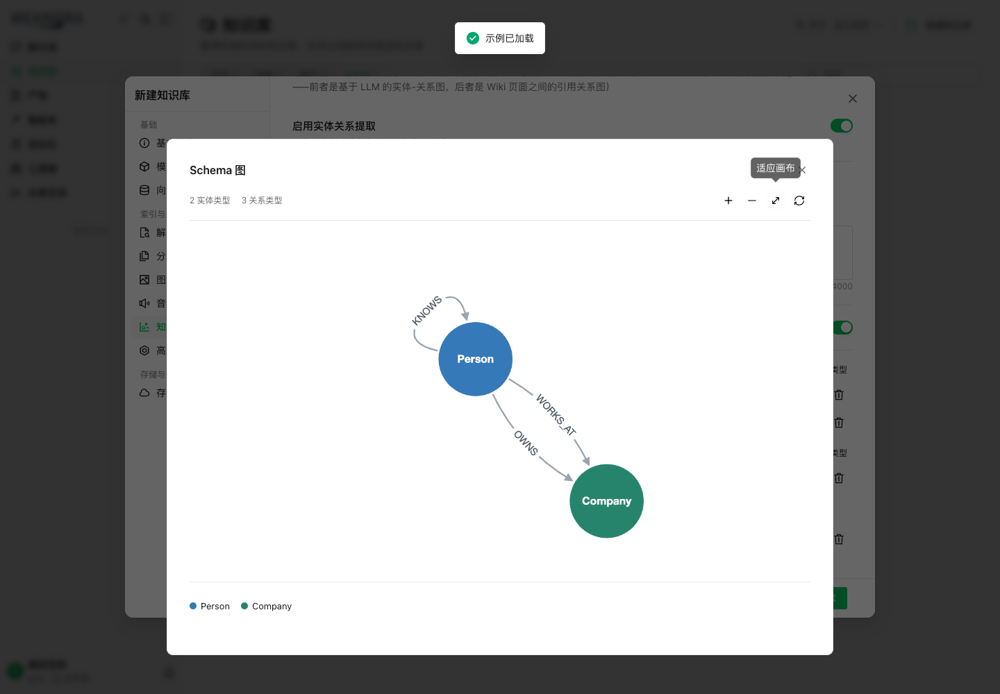

# Optional Graph Schema

Graph extraction supports an optional domain schema in `extract_config.schema`.
It is disabled by default. Legacy relation tags remain available when schema
mode is disabled. Sample text, example entities, relations and extraction
actions remain available in both modes.

## Configuration

```json
{
  "extract_config": {
    "enabled": true,
    "custom_instructions": "Extract only explicitly named people and employers.",
    "schema": {
      "enabled": true,
      "entity_types": [
        {"name": "Person", "description": "A named individual"},
        {"name": "Company", "description": "An employer"}
      ],
      "relation_types": [
        {"name": "WORKS_AT", "source_type": "Person", "target_type": "Company"}
      ]
    }
  }
}
```

The schema accepts 1-50 entity types and up to 100 directed relation definitions.
A relation name can be reused for different endpoint pairs. Descriptions are
optional semantic guidance. This version does not support entity properties.
Supplemental extraction instructions remain available in either mode.

In the knowledge base or upload graph settings, enable schema mode, edit the
entity and relation definitions, and click Preview beside the schema switch.
The dialog supports dragging circular nodes, panning, zooming, fit and force
layout, with directed arrows for parallel relations and self loops. The preview
shows the domain schema, not the extracted instances. Toggling the mode or
disabling extraction retains inactive configuration.



In schema mode, example entities select a declared type and example relations
select a directed schema triple with matching typed endpoints. Same-named
entities of different types remain distinct. Entity attributes are only edited
in legacy mode. The default example uses the current schema rather than legacy
book/author data. Example extraction sends the schema to the extraction API.
Generate Random Text is available in either mode. In schema mode the text
generation endpoint accepts the current schema and uses its types, directed
relations and descriptions instead of legacy tags. This generates prose, not
validated graph data; the extraction step still validates the resulting graph.
Persisted examples are included as few-shot messages only after passing the
same schema validation as generated output. Old untyped or incompatible
examples are retained for editing, reported in the UI and omitted from prompts
until corrected.

## Extraction And Retrieval

Schema mode generates both the extraction prompt and an output JSON Schema.
Every response is checked for structure, declared types, unique local entity IDs,
valid references and directed endpoint types before storage. Invalid output gets
at most one repair call; transport errors and truncated responses fail without
that repair. The existing cross-provider model interface does not universally
expose native strict structured output, so this is backend validation, not a
guarantee that providers constrain generation.

Neo4j stores `entity_type` with the node identity `(document, name, entity_type)`.
Identical names with different types are distinct. Legacy untyped entities remain
separate. A document-local lazy backfill sets the missing discriminator on legacy
nodes to an empty string; no historical content is re-extracted.

Schema entities also carry the internal `WEKNORA_SCHEMA_ENTITY` Label and
`schema_scope` knowledge-base ID. A single composite uniqueness constraint on
`(schema_scope, kg, name, entity_type)` prevents concurrent chunk workers from
creating duplicate identities. The constraint is initialized before typed writes
in a separate schema transaction; the Neo4j account needs constraint-management
permission (or an operator can create the constraint beforehand). Pre-constraint
typed records in the current document are upgraded in place before merging.
Existing duplicate identities cause an explicit write failure; reprocess the
affected document to rebuild its graph rather than silently discarding evidence.
The constraint does not apply to legacy untyped entities or merge across documents.

Typed nodes additionally receive a derived Label, for example `TYPE_Person`,
alongside the existing knowledge-base and document namespace Labels. The `TYPE_`
prefix is reserved for entity classifications; exact type names are preserved
without normalization, and passed as parameters rather than executable Cypher.
The `entity_type` property remains the authoritative identity and API value.
Writes match using namespace and internal uniqueness Labels and identity first, then add the derived
Label in the same transaction, including relationship-only endpoint imports.
This upgrades property-only typed records without duplicating nodes or losing
chunk references. Untyped legacy entities receive no type Label.

Typed retrieval checks the property and derived Label, with a compatibility
path for records that have no `TYPE_` Labels yet. A mismatched type Label alone
cannot qualify as the expected type. No full-database Label migration is
performed; existing property-only typed nodes gain Labels when written again.
Label membership filtering does not automatically imply an index seek or a
performance improvement: substring name matching and optional filters still
require query-plan review and benchmarking. The seed and result caps bound
expansion and returned rows, not all work scanning candidates before the caps.

Question understanding generates optional entity type, relation, direction and
neighbor type hints. Identical schemas within a request share one understanding
call. Neo4j applies these hints to bounded one-hop retrieval. The agent graph tool
also accepts `entity_type`, `relation_type`, `direction` (`in` or `out`) and
`target_type`, and rejects filters incompatible with the target knowledge base.

Hints are semantic constraints, not access permissions. When typed retrieval has
no usable live evidence within the requested scope, name-only fallback stays in
the same authorized knowledge base and document namespace. Disabled or deleted
chunks, deleted documents and evidence outside the document/tag scope do not
prevent fallback. Valid typed evidence already returned by text retrieval still
counts as a hit. Graph or evidence-store errors do not trigger fallback.
SQL document and chunk evidence checks apply to fallback results too.
Consequently, fallback can return evidence outside the requested type filter;
explicit filters are not a strict query API.

Entity-only schemas are valid for extraction and storage, but the current graph
retrieval expands relationship edges. Isolated entities do not contribute graph
retrieval candidates; regular text and vector retrieval remain available.

Changing a schema does not migrate or reparse existing documents. Reprocess
documents to apply the new extraction rules. Cross-document entity resolution,
multi-hop planning and instance graph browsing are not part of this feature.

## Verification

```sh
go test ./internal/types ./internal/application/service/chat_pipeline \
  ./internal/application/repository/retriever/neo4j ./internal/handler \
  ./internal/agent/tools ./docs

go test ./internal/application/service \
  -run 'Test.*(Schema|ResolveProcessConfig|KnowledgeProcess|ExtractConfig|ChunkExtractHandle)'

cd frontend
npm test -- src/types/graphSchema.test.ts \
  src/types/schemaGraphPreview.test.ts \
  src/views/knowledge/settings/GraphSettings.test.ts \
  src/views/knowledge/graphExampleRoundTrip.test.ts \
  src/views/knowledge/KnowledgeBaseEditorModal.test.mjs \
  src/assets/theme/styleGuard.test.mjs
npm run type-check
npm run check-i18n
npm run build
```

The gated Neo4j regression requires a development instance with APOC, never a
production database. It creates isolated temporary knowledge-base namespaces and
cleans their nodes afterwards. It also creates the shared schema identity constraint.
Authenticated instances may set `WEKNORA_NEO4J_TEST_USER` and
`WEKNORA_NEO4J_TEST_PASSWORD`; omit these for authentication-disabled instances:

```sh
WEKNORA_NEO4J_TEST_URI=bolt://127.0.0.1:17687 \
  go test ./internal/application/repository/retriever/neo4j -run TestSchemaGraphIntegration -v
```
