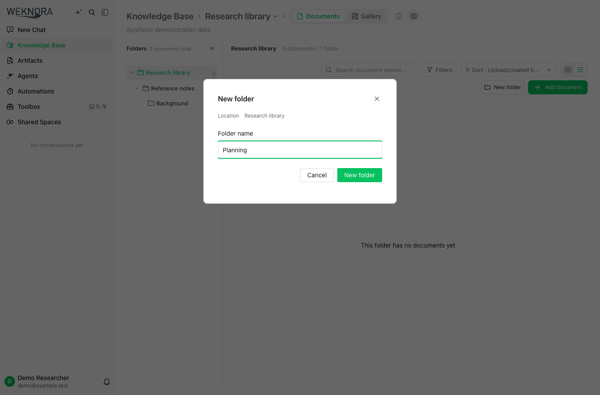
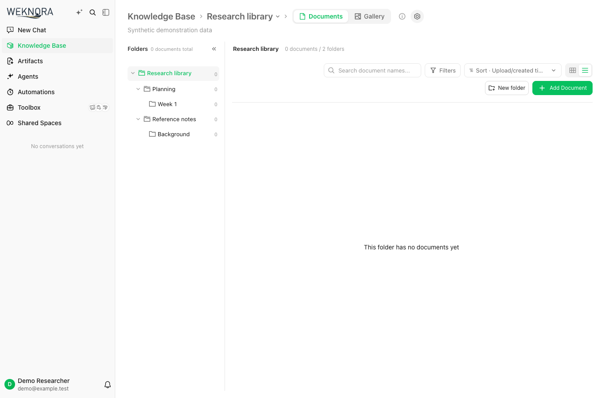

# Document folders

Document placement remains in `knowledges.folder_path`. The directory tree combines
those existing paths with user-created rows in `knowledge_folders`; a marker adds
zero documents. There is no placeholder file, document migration, reparse, or
embedding operation. Explicit directories persist when emptied. Legacy paths
without an explicit marker retain their existing derived behavior.

All routes below are under `/api/v1`. Listing retains the existing Viewer and
knowledge-base read scope. Mutations retain the existing ownership, tenant,
knowledge-base write and API-key ingest scope checks; there is no folder-specific ACL.

## Create an empty folder

`POST /knowledge-bases/{id}/knowledge/folders`

```json
{"parent_path":"项目/资料","name":"会议"}
```

Omit `parent_path` or send `""` for the root. A non-root parent must already exist
in this KB as either an explicit directory or a derived path. The name is one
segment: whitespace is trimmed; empty names, `.`, `..`, separators, control
characters, unsafe input and trailing periods are rejected. Limits are 128 UTF-8
bytes per name, 1024 bytes per full path, and 16 levels. Inputs are not silently
truncated.

```json
{"success":true,"data":{"path":"项目/资料/会议","name":"会议","document_count":0,"total_count":0}}
```

Success is HTTP 201. Invalid input is 400; a missing parent is 404; any existing
explicit or derived sibling path is 409. A unique `(tenant_id, knowledge_base_id,
path)` key also rejects concurrent duplicate creation.

## Delete only an empty folder

`DELETE /knowledge-bases/{id}/knowledge/folders/empty?path=项目%2F资料%2F会议`

Success is HTTP 200 with `{"success":true,"data":{"path":"项目/资料/会议"}}`.
A missing or invalid path, including the root, is 400; a missing directory is 404;
a directory with a file or any descendant directory is 409. The conditional SQL
deletes only the explicit marker and never deletes, moves or modifies documents.

## Existing operations

- `GET .../folders` retains its response shape and document-count semantics,
  including explicit empty directories after refresh.
- `PUT .../folders` retains its existing rename/move and merge semantics. It now
  rewrites explicit descendant markers in the same transaction as document paths.
  A successful empty-directory rename may report `moved_count: 0` because this
  field still counts documents.
- Ordinary file moves and deletes preserve explicit markers. They do not convert
  all legacy paths into persistent directories.
- Clear-contents requests enqueue `clear_folders` in the existing deletion task,
  including when there are no documents. Markers are cleaned after document
  cleanup succeeds; failures retry in that same task. Whole-KB deletion also
  cleans markers, independently of vector-store cleanup.

## Schema and rollback

PostgreSQL migration 136 and SQLite migration 52 create the new table without
changing existing document rows. Their down migrations drop only this table.
Application code that reads it must be rolled back before dropping it; dropping
the table loses every explicit directory marker and its creation timestamp. Empty
directories disappear; populated directories remain inferable from document paths.
Existing document rows and paths remain intact. Database backups and restores must include the new table. Before a down migration, export every marker row including `created_at`; document
paths cannot reconstruct empty folders or their creation timestamps.


## Safe upload and move destinations

The UI fixes the destination knowledge base when opening upload confirmation.
Navigation to another KB while the confirmation is open does not change the
queued upload or its retries. The original destination remains visible in the
confirmation. A cancelled confirmation does not queue files.

File upload multipart data and ordinary file-move JSON accept an optional
`existing_folder_anchor`. An explicitly empty string means the KB root; an
omitted field is different. A non-root anchor must already exist and must be the
requested path or one of its ancestors. Choosing an existing folder uses that
folder as the anchor. Creating a new relative destination uses the existing
ancestor selected when creation began. Nested temporary paths and retries retain
that original anchor; a refreshed tree never silently weakens it to the root.

The backend checks placement before slow upload I/O and again under the same
KB transaction lock as directory mutations. If the existing ancestor was removed,
renamed, or replaced during the operation, the upload fails with HTTP 409 and
keeps the existing documents intact. Refresh and select a destination explicitly;
do not automatically retry with a different location. Root imports can still
introduce new relative directory paths.

An old upload client without the anchor captures the deepest existing ancestor
at request time. It cannot express a selection made earlier in its UI. Ordinary
file moves without an anchor now require the target to exist. To intentionally
create a path below an existing directory, send its anchor explicitly (including
`""` for the root). A moved/deleted/out-of-scope ID in a batch makes the whole
move fail; the server does not report partial moves as complete.

## Source updates and processing

Directory mutation locks are per tenant and KB. Cross-KB transfer obtains both
KB locks in a deterministic order and retains its version check. A rename first
validates every resulting document and marker path; exceeding the path budget
returns 400 with no partial rewrite. Legal directory merges remain supported.

Background saves may update processing fields only while the document still has
the source and KB version they loaded. They cannot restore an old folder path,
old source file, or previous KB, and a missing row is not reinserted by a save.
Reparse admission is claimed atomically before queue cancellation or resource
cleanup. A stale request that lost to transfer or replacement must fail before
removing chunks or vectors. Pending/processing/finalizing documents reject a
new public reparse or replacement; cancel the active work first when appropriate.

File replacement preserves the current local directory. A replacement filename
cannot implicitly move the document to another directory; use the dedicated
move operation. Failed or superseded source updates do not blindly restore a
previous file pointer or delete a potentially referenced blob.

Datasource updates retain the upstream atomic replacement protocol: a new
knowledge ID replaces the old row, and external cleanup happens only after the
replacement commits. Both file and URL replacements keep the current local
folder instead of adopting a path from the incoming filename. A concurrent
rename makes the stale replacement fail its version check before retirement;
a subsequent explicit retry loads the new location. ConflictStrategySkip and
normal creation of new datasource items keep their existing behavior.

These changes do not add a table or grant beyond migration 136. Deploy the app
and its workers from the same reviewed build; do not mix old writers that ignore
these guards with new writers. The full-KB clear operation remains an asynchronous
clear operation, not a guarantee that newly created empty folders survive its
later cleanup. URL/manual creation currently retains its existing root placement.

## Storage design and scope

This extends the existing materialized path model. `knowledges.folder_path` remains
the document placement field; there is no `folder_id`, `parent_id`, closure table,
or document backfill. The four-column marker table contains only tenant, knowledge
base, canonical path and creation time. Existing derived directories do not need
marker rows. Listing appends zero-count explicit paths to the existing document
counts and builds the same tree; no placeholder knowledge or embedding is created.

The empty-only DELETE endpoint is deliberately separate from a recursive document
deletion API. It refuses a directory with any file or descendant, and changes only
its marker. Existing rename/merge behavior is retained; this change adds no drag
and drop interface. URL/manual creation still uses its existing root placement.

Creating an explicit directory is different from converting all existing derived
paths into persistent folders. A duplicate derived path returns 409; legacy paths
still disappear when their final document disappears. Explicit paths survive.

A string destination anchor cannot detect delete/recreate cycles completed before
the server captures its witness. It is not a stable folder identifier. The source
and placement guards cover admitted operations without replacing path identity.

## UI example

These screenshots use a local production frontend build with synthetic in-memory
API fixtures; they contain no real workspace data. Database persistence and
concurrency are tested separately.




