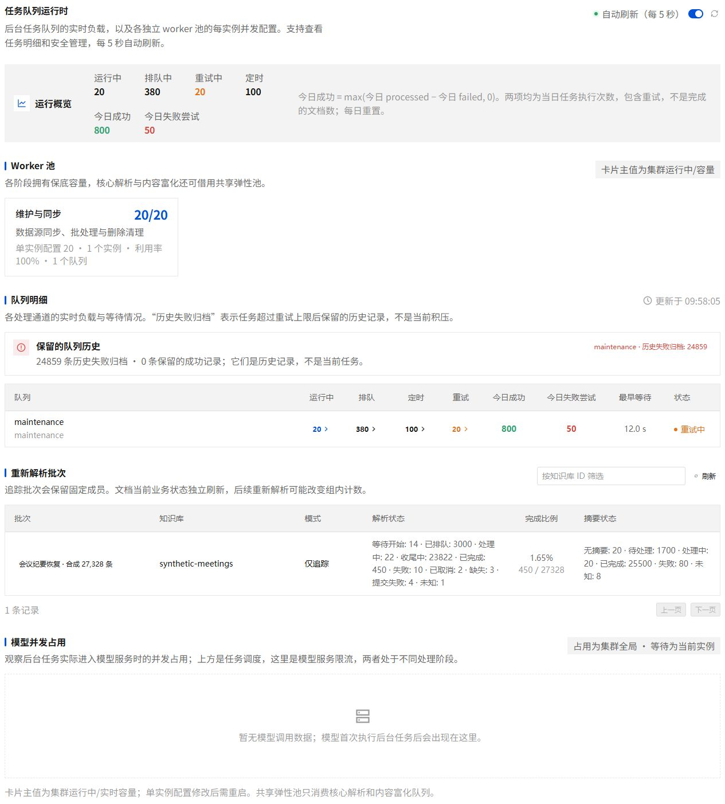
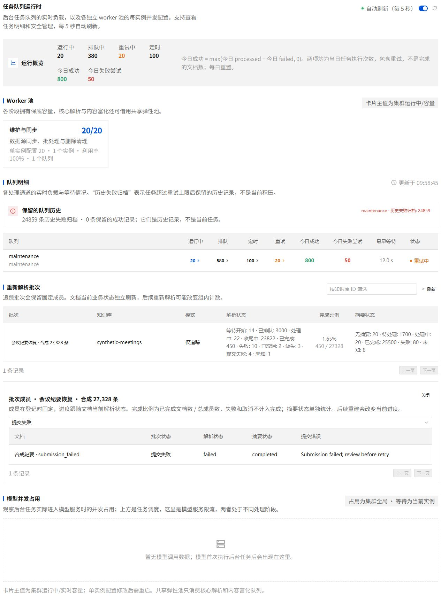

# Reparse progress maintenance

## Metric contract

Queue archives are historical failed task records, not the current failed document count. Archives remain available for inspection and explicit management. Asynq `processed` includes today's successful and failed task executions; today's successful executions are `max(processed - failed, 0)`. Retries are executions too. Daily counters follow the queue server's day boundary and are not lifetime document counts. `completed` is the number of retained successful task records and can be zero even when documents have completed. See the [Asynq v0.26.0 QueueInfo definitions](https://github.com/hibiken/asynq/blob/v0.26.0/inspector.go).

Batch membership is frozen. Progress follows each member's **current document state**. A later rebuild changes a member's displayed progress. Only `completed / total` is the completion ratio; failures and cancellations are not successful completion. Summary status is reported independently from document parsing status. Managed members that have not been dispatched show their submission phase first (waiting, queued, submission failed or unknown), so a retained failure or completion from an older parse is not mistaken for the new submission.

## API and migration

Apply the migration for the configured database (PostgreSQL or SQLite) with the application using the normal migration workflow. The new tables contain batch identifiers, member identifiers, dispatch receipts and short error summaries. They do not copy document text or credentials. Deploy this change through the existing release process; this PR does not deploy production or remove archived tasks.

The migration versions are PostgreSQL `000134` and SQLite `000051`. Their down migrations remove the three tracking tables and their tracking history. They do not change knowledge rows, chunks, parsing counters or queued tasks. Preserve tracking data before an intentional rollback if that history is needed.

`POST /api/v1/knowledge/reparse-batches` registers `{kb_id, ids, mode, name?, manifest_sha256?}`. Registration does **not** enqueue any work. `mode=managed` supports new requests; `tracking_only` records an already submitted frozen scope. IDs are deduplicated with a maximum of 50,000. Canonical manifest digest is SHA-256 of sorted unique UTF-8 IDs, separated by LF and ending with LF. The same tracking-only manifest in the same knowledge base returns the existing tracking record.

List batches with `GET /api/v1/knowledge/reparse-batches?kb_id=...&page=1&page_size=20`; read one at `/:batch_id`, and inspect members at `/:batch_id/items?page=1&page_size=50&state=failed`. These endpoints use the existing tenant, space, knowledge-base and API-key authorization rules. Original task payloads are not exposed.

`POST /api/v1/knowledge/batch-reparse` retains its 200-member limit and existing `task_id`/`reparse_count` response fields, adding `batch_id`. A managed batch can be supplied using `batch_id`. Reuse an `Idempotency-Key` for transport retries of the same action, and choose a new key for a new action. Do not change the request body while reusing the same key. The server keeps durable dispatch receipts and deterministic wrapper task IDs. An ambiguous interrupted dispatch must be reviewed instead of blindly rebuilding the same document again.

## Backfill an existing frozen manifest

Keep production manifests, source backups, hostnames and credentials outside Git. The import script reads only `kb_id` and `entries[].id` (and validates `knowledge_base_id` when present). It discards titles, contents and operational metadata before sending the request.

First validate locally (no network and no API key required):

```sh
python scripts/import_reparse_batch.py /private/path/manifest.json --expected-count 27328 --dry-run
```

After the new application version is released, supply an existing authorized API key through `WEKNORA_API_KEY`, then register the same manifest:

```sh
python scripts/import_reparse_batch.py /private/path/manifest.json --expected-count 27328 --base-url "$WEKNORA_BASE_URL" --name "Meeting recovery"
```

The script only calls the registration endpoint with `mode=tracking_only`. It never calls the reparse endpoint, mutates knowledge rows or inspects Redis. Repeating the frozen manifest recovers the same batch through the digest. Compare the dry-run count and digest with the returned receipt. Registration and status reads must leave document state, queued-task count and parse invocations unchanged. Do not mistake batch registration for parse completion.

Run importer tests with `python -m unittest discover -s scripts -p test_import_reparse_batch.py`.

## Validation and synthetic acceptance

The focused Go suite runs in Go 1.26 with no production database, Redis or model endpoint:

```sh
go test -p 2 ./internal/application/repository ./internal/application/service ./internal/handler ./internal/router ./internal/database -run 'Reparse|Migration' -count=1
```

The PostgreSQL concurrency/migration test is opt-in through `WEKNORA_REPARSE_TEST_POSTGRES_DSN`. It requires an isolated database named `weknora_reparse_test` and refuses any other database name. It verifies that simultaneous overlapping submissions in different batches produce one durable owner, runs the same current-state aggregation as SQLite, and exercises the PostgreSQL down/up DDL. The SQLite migration test also verifies that rollback/up leaves existing business rows and pending operations intact.

The large-member fixture mixes current parsing states, missing/soft-deleted rows and another tenant. It checks count conservation and the bounded query shape for detail and filtered pages. The query counter includes raw SQL scans. Registration uses bounded inserts and managed ownership checks so the 50,000-member limit also works with SQLite parameter limits.

Browser acceptance mounts the real runtime page against local synthetic APIs. It verifies daily executions alongside unchanged historical archives, independent summary counts, member-state filtering, and the retained archive drawer. The screenshots show simulated records only.





Validation on the current upstream base passed: the focused Go suite (79 tests; six opt-in cases skipped in that run), the separately enabled PostgreSQL concurrency/migration test, `go vet` for the five affected packages, the server build and diff-scoped Go lint (zero issues). Frontend checks used `npm ci` with the tracked lockfile: type checking, five metric tests, fifteen i18n tests and the full Vite build passed; six importer tests also passed. Browser acceptance on the ported component confirmed localized daily metrics, historical archives, the completion ratio, separate summaries and member-state filtering. The locale audit explicitly checks the new metric paths so matching incomplete locale bundles cannot hide a missing label.

A production backport was validated separately against an existing deployment, preserving its local patches and migration history. The existing frozen manifest was registered in `tracking_only` mode and the returned totals were compared with database aggregates. Duplicate registration returned the same batch, created no submission receipts, and sent no reparse request. Production configurations, manifests, document contents and credentials are excluded from this change; screenshots use synthetic data only.
