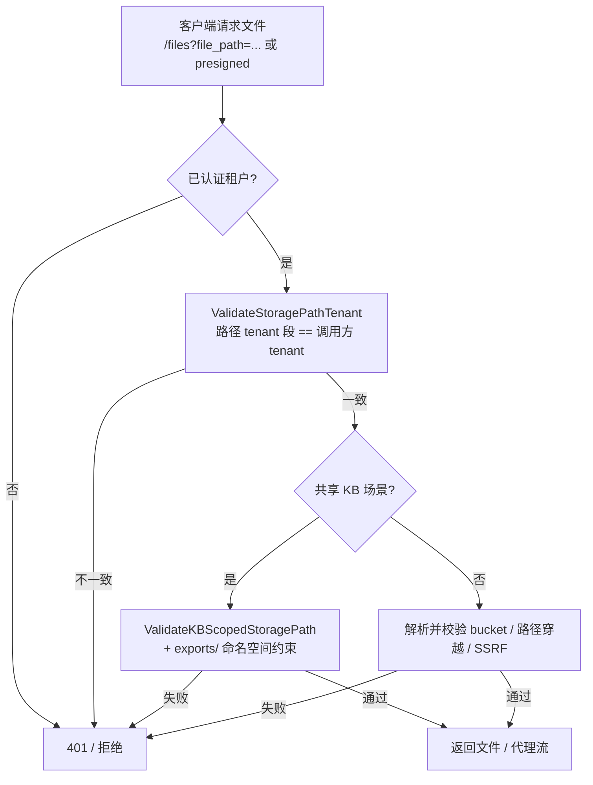

# 多租户数据隔离（存储层）

WeKnora 通过统一的租户上下文（`tenant_id`）在一个部署内服务多个工作空间。本文说明**存储层**的隔离模型：哪些隔离由应用层强制、哪些需要你在对象存储侧自行加固，以及合规要求"物理隔离"时应如何配置。

::: warning 核心结论
对象存储（MinIO / S3 / COS / OSS 等）在**裸存储层面不提供租户级 IAM**——默认共享后端是「单 bucket + 单套凭证 + 路径前缀区分租户」。租户之间的隔离由 **WeKnora 应用层校验**保证，而不是由存储服务本身保证。若凭证泄露或应用进程被攻破，所有租户的原始文件在存储侧是互通的。需要硬隔离（不同 bucket / 不同凭证 / 存储侧 IAM 策略）时，应使用[按租户的存储后端](#_4-按租户存储后端硬隔离)。
:::

## 隔离的三个层次 {#_1-隔离的三个层次}

| 层 | 默认形态 | 隔离如何保证 | 隔离强度 |
| --- | --- | --- | --- |
| 业务元数据 / 数据库 | 单库，`tenant_id` 列 | ORM / 仓库层按租户上下文自动过滤；Agent 自生成 SQL 经 `pg_query_go` 注入 `tenant_id`（见[租户与鉴权](../03-features/01-tenant-auth.md)） | 逻辑隔离（应用层） |
| 对象存储（共享后端） | 单 bucket + 单凭证 + `{tenant_id}/...` 路径前缀 | **应用层**在文件代理入口校验路径归属；存储本身无租户 IAM | 逻辑隔离（应用层）；存储侧无强制 |
| 对象存储（按租户后端） | 每租户独立 bucket + 独立凭证（`tenant.StorageEngineConfig`） | 存储凭据本身按租户隔离，跨租户连不上对方桶 | **物理 / 凭据级隔离** |

> 注意：数据库与向量存储的隔离同样依赖 `tenant_id` 过滤（逻辑隔离）。本文聚焦对象存储，因为这里是"裸存储无 IAM"最容易被误解的一环。

## 共享后端下的存储路径约定 {#_2-共享后端下的存储路径约定}

当未配置按租户存储后端时，所有租户的文件写入同一个对象存储 bucket，靠 object key 里的租户段区分：

```
minio://<bucket>/<tenant_id>/<knowledge_id>/<uuid>.<ext>
s3://<bucket>/<prefix>/<tenant_id>/...
oss://<bucket>/<prefix>/<tenant_id>/...
local://<tenant_id>/...
```

`tenant_id` 在这里只是**路径字符串前缀**，不是存储服务理解的访问控制标识。存储服务不会因为 key 里写了某个 `tenant_id` 就拒绝另一个租户读取——它只看 bucket + 凭证。

因此共享后端下，跨租户保护的**唯一防线**是应用层：WeKnora 在对外提供文件的入口校验"请求方已认证的租户"与"路径里的租户段"是否一致。

## 应用层强制机制 {#_3-应用层强制机制}

以下机制共同保证：在共享后端下，已认证租户只能访问自己（或经授权共享）的文件。

### 路径租户归属校验

对外文件代理（`internal/router/files.go`）在返回文件前调用：

```go
// 非 KB 共享场景：校验 filePath 里的 tenant 段 == 已认证 tenant.ID
if err := secutils.ValidateStoragePathTenant(filePath, tenant.ID); err != nil {
    c.JSON(http.StatusForbidden, gin.H{"error": "forbidden: file path not accessible"})
    return
}
```

`secutils.ValidateStoragePathTenant`（`internal/utils/presign.go`）解析路径中的租户段，与调用方租户比对，不一致直接拒绝。

### 共享知识库的范围约束

`secutils.ValidateKBScopedStoragePath` 用于跨空间共享知识库的图片代理（`/api/v1/knowledge-bases/:id/files`），在租户校验之外额外要求路径落在 `exports/` 命名空间，防止共享只读方借代理读取属主租户的原始上传文件。

### 预签名链接的租户绑定

`/api/v1/files/presigned` 返回的限时直链用 HMAC 把 `filePath` 与 `tenantID`、过期时间绑定（`signPayload` 生成、`VerifyFileURLSig` 用 `hmac.Equal` 校验）。客户端无法用别的租户路径伪造出合法签名。

### 存储连接的纵深防护

- **SSRF 防护**：endpoint 经 `utils.ValidateURLForSSRF` 校验，并走 `SSRFValidatingRoundTripper`，阻止 Agent / 解析服务探测内网。
- **bucket 匹配**：`minioFileService.parseMinioFilePath` 校验路径声明的 bucket 必须等于实例配置 bucket，防止跨 bucket 访问。
- **路径穿越防护**：`utils.SafeObjectKey` 拒绝 `../` 等穿越片段。



## 按租户存储后端（硬隔离） {#_4-按租户存储后端硬隔离}

若合规或合同要求"不同租户的数据在存储侧也不能互通"（不同 bucket / 不同凭证 / 可施加存储侧 IAM 策略），WeKnora 原生支持**按租户的存储后端**：

- 每个工作空间（或知识库）可配置独立的 `tenant.StorageEngineConfig`（provider、endpoint、独立 `access_key_id` / `secret_access_key`、独立 `bucket_name`）。
- 文件访问经 `ResolveTenantFileServiceWithFallback` → `NewFileServiceFromStorageConfig` 解析到该租户自己的存储连接；路径以 `storage://<backendID>/` 包装，跨后端访问直接报 `storage backend mismatch`。
- 凭证在 `storage_backends` 表的 `config` 字段中经 AES-GCM 加密保存（`utils.EncryptAESGCM`），读取时解密，接口响应掩码显示。

配置方式见[存储后端](../03-features/19-storage-backends.md)。这是达到"存储侧物理 / 凭据级隔离"的推荐路径，无需改动内核。

## 安全边界与运维建议 {#_5-安全边界与运维建议}

### 共享后端的真实风险面

共享后端下，以下情况会绕过应用层、直接暴露所有租户文件：

1. **对象存储凭证泄露**（如 `MINIO_SECRET_ACCESS_KEY`、云 AK/SK 落入不可信环境）——持有者可用同一套凭证列出 / 读取任意租户前缀。
2. **应用进程被攻破**——攻击者在进程内可直接构造任意 `filePath`，应用层校验形同虚设。

这两点不是"漏做的权限"，而是"逻辑隔离"设计的固有边界：**隔离强度等于应用层校验的强度，存储侧不二次兜底**。

### 加固清单

- **生产优先使用按租户存储后端**：让不同租户的 bucket / 凭证分离，即使某一租户凭证泄露也不会波及其他租户；并可在存储侧附加 bucket policy / IAM 策略做纵深。
- **最小化存储网络暴露**：对象存储 endpoint 不要公网可达，或由独立网络策略限制来源；默认 MinIO（`minio:9000`）仅在 compose 网络内可达，部署到公网前务必处理。
- **凭证轮换与最小权限**：为存储凭证配置最小权限（仅限指定 bucket），定期轮换；避免把同一套全局凭证复用到不可信组件。
- **开启 SSRF 防护**：`SSRF_DNS_WHITELIST_ONLY` + `SSRF_WHITELIST` 限制出站，防止 Agent / 解析服务探测内网存储。
- **API Key 管理**：API Key 为长期静态凭证，泄露即对应能力/知识库暴露，按"能力 + 知识库白名单"最小化发放，并定期轮换（参见 [SECURITY.md](https://github.com/Tencent/WeKnora/blob/main/SECURITY.md)）。

### 与数据库 / 向量隔离的关系

数据库和向量检索同样依赖 `tenant_id` 逻辑过滤。若需要数据库 / 向量也做物理隔离（不同 database / 实例），应结合部署拓扑在数据源层做租户到连接的路由——该部分超出本文范围，请以你锁定的版本部署文档与 `config/config.yaml` 为准。

## 实现参考 {#_6-实现参考}

| 关注点 | 位置 |
| --- | --- |
| 文件代理入口的租户校验 | `internal/router/files.go`（`ValidateStoragePathTenant` 调用） |
| 路径租户解析与校验 | `internal/utils/presign.go`：`ValidateStoragePathTenant`、`ValidateKBScopedStoragePath`、`ParseTenantIDFromStoragePath` |
| 预签名 HMAC | `internal/utils/presign.go`：`signPayload` / `VerifyFileURLSig` |
| SSRF 与路径穿越防护 | `internal/utils/security.go`：`ValidateURLForSSRF`、`SafeObjectKey` |
| MinIO bucket 匹配 | `internal/application/service/file/minio.go`：`minioFileService.parseMinioFilePath` |
| 按租户后端解析与兜底 | `internal/application/service/file/resolve_tenant.go`：`ResolveTenantFileServiceWithFallback` |
| 按租户后端包装 | `internal/application/service/file/backend_scoped.go`：`backendScopedFileService`、`storage://<backendID>/` |
| 存储后端配置与凭证加密 | `internal/types/storagebackend.go`：`StorageBackendConfig.Value`（`utils.EncryptAESGCM`）；`internal/application/service/file/factory.go`：`NewFileServiceFromStorageConfig` |
| Agent SQL 的租户注入 | `internal/agent/tools/database_query.go`：`validateAndSecureSQL` → `utils.ValidateAndSecureSQL`（`WithSecurityDefaults(tenantID)`） |
| 按租户存储配置数据模型 | `storage_backends` 表（`tenant_id` 隔离，软删除）；字段见[存储后端](../03-features/19-storage-backends.md) |

本文基于对当前 `main` 分支源码的核对；不同版本的实现路径可能变化，请以你实际部署版本的代码为准。
